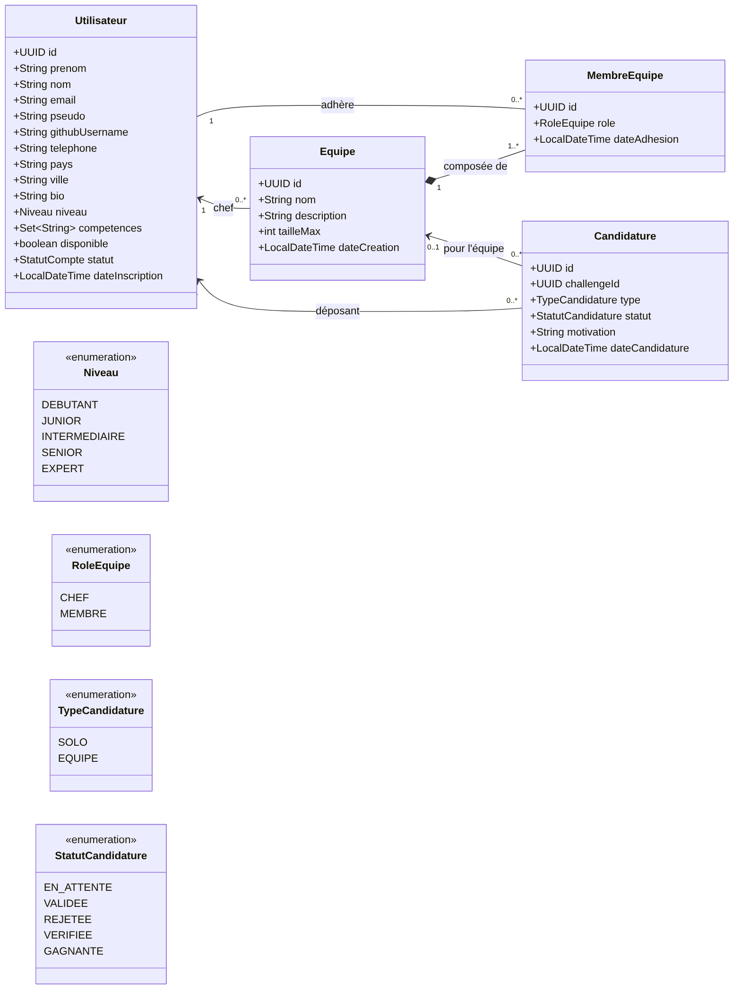

# Arène — Plateforme de hackathons & bounties (MT-41)

Architecture Web Distribuée · ESPRIT · 2026-2027
Atelier : **Eureka Server (2 instances) + Observabilité avec Spring Boot Actuator**

## 👥 Équipe

| Membre | Microservice | Technologie | Port(s) |
|---|---|---|---|
| _Nom Prénom_ (M1) | MS1 · Challenges | Spring Boot + mysql | 8081 |
| _Naima …_ (M2) | **MS2 · Participants** | Spring Boot + mysql | **8082 / 8092** |
| _Nom Prénom_ (M3) | MS3 · Soumissions | Spring Boot + mysql | 8083 |
| _Nom Prénom_ (M4) | MS4 · Évaluation | Spring Boot + MySQL | 8084 |
| _Nom Prénom_ (M5) | MS6 · Réputation | Spring Boot + mysql | 8086 |
| Équipe | Eureka Server | Spring Cloud Netflix | **8761 / 8762** |

## 🏗️ Architecture

```
                 ┌──────────────────────┐  réplication  ┌──────────────────────┐
                 │ Eureka peer1 :8761   │ ◄───────────► │ Eureka peer2 :8762   │
                 │ (hostname localhost) │               │ (hostname 127.0.0.1) │
                 └──────────▲───────────┘               └──────────▲───────────┘
                            │ register + heartbeat (10 s)          │ (bascule si peer1 tombe)
   ┌───────────┬────────────┼──────────────┬─────────────┬─────────┴──────┐
 MS1 :8081  MS2 :8082   MS2 :8092      MS3 :8083     MS4 :8084     ...
                                                                     MS6 :8086
```

- Chaque client déclare **les deux** serveurs : `defaultZone=http://localhost:8761/eureka/,http://127.0.0.1:8762/eureka/`.
- Il s'enregistre sur le 1er ; le 1er **réplique** vers le 2e → les deux dashboards montrent tous les services.
- Les deux pairs ont des noms d'hôte différents (`localhost` / `127.0.0.1`), sinon Eureka pense que son pair est lui-même et ne réplique pas.
- Actuator : `/actuator/health` est transmis à Eureka (`eureka.client.healthcheck.enabled=true`) → un service malade passe **DOWN** dans le dashboard.

## 📦 MS2 · Participants — modèle de données (corrigé)



- **Utilisateur** : une personne (développeur, rôle Keycloak `DEVELOPER`) avec identité, contact, GitHub, niveau, compétences.
- **Equipe** : un groupe d'utilisateurs, avec un **chef** (Utilisateur) et une taille maximale.
- **MembreEquipe** : classe d'association N..N Utilisateur ↔ Equipe (rôle CHEF/MEMBRE + date d'adhésion).
- **Candidature** : inscription à un défi, **SOLO** (un utilisateur) ou **EQUIPE** ; `challengeId` référence MS1 par identifiant (pas de FK inter-services).

### API MS2

| Méthode | Route | Rôle |
|---|---|---|
| POST / GET | `/api/users` | Créer / lister les utilisateurs |
| GET / PUT / DELETE | `/api/users/{id}` | Consulter / modifier / supprimer |
| GET | `/api/users/{id}/teams` · `/api/users/{id}/applications` | Ses équipes / ses candidatures |
| POST / GET | `/api/teams` | Créer (le chef devient membre) / lister |
| GET / PUT / DELETE | `/api/teams/{id}` | Consulter / modifier / supprimer |
| POST / DELETE | `/api/teams/{id}/members[/{userId}]` | Ajouter / retirer un membre |
| POST / GET | `/api/applications` | S'inscrire à un défi / lister |
| GET / PUT / DELETE | `/api/applications/{id}` | Consulter / modifier motivation / se désinscrire |
| PATCH | `/api/applications/{id}/status` | Changer le statut |
| GET | `/api/challenges/{challengeId}/applications` | Inscrits d'un défi (appelé par MS4) |
| GET | `/api/participants/hello` | Indique quelle instance répond (port) |

Swagger : http://localhost:8082/swagger-ui.html 

## ▶️ Lancement (ordre)

1. Eureka peer1 : `cd eureka-server && mvn spring-boot:run -Dspring-boot.run.profiles=peer1`
2. Eureka peer2 : `cd eureka-server && mvn spring-boot:run -Dspring-boot.run.profiles=peer2`
3. MS2 instance 1 : `cd ms2-participants && mvn spring-boot:run`
4. MS2 instance 2 : `cd ms2-participants && mvn spring-boot:run -Dspring-boot.run.arguments=--server.port=8092`
5. Les autres MS de l'équipe.

Dashboards : http://localhost:8761 et http://localhost:8762


