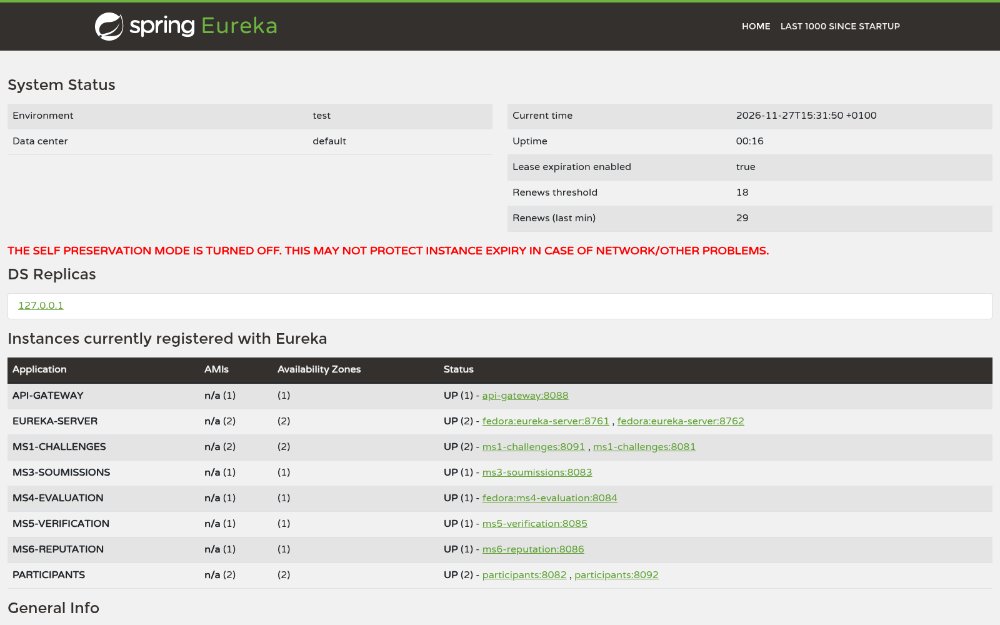
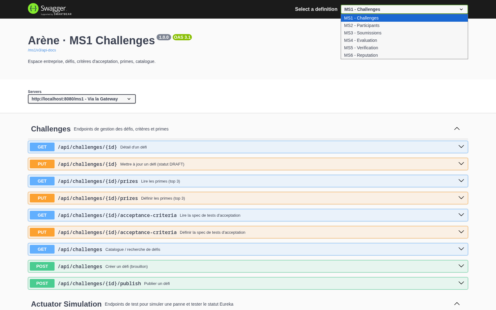
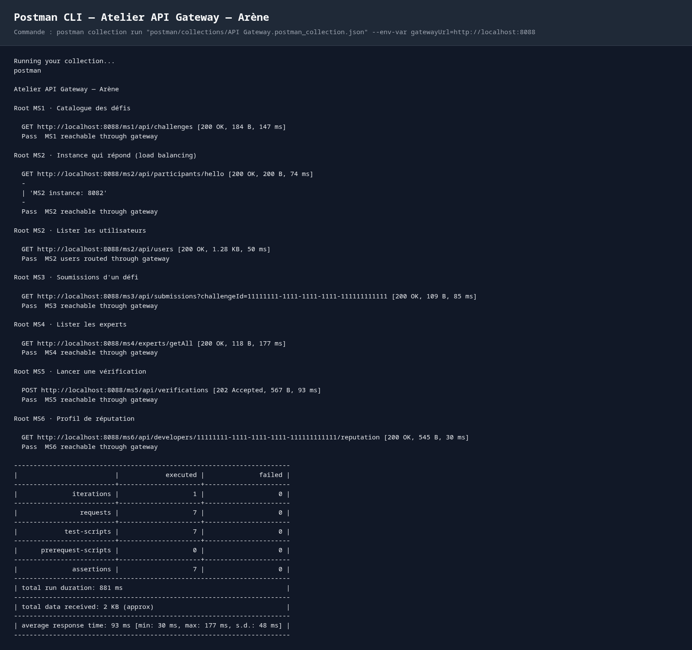

# Arène — Plateforme de hackathons & bounties

Module **Applications Web Distribuées · MT-41**.

## Sujet

**Arène** est une plateforme de hackathons et de challenges à bounties. Une entreprise publie un
défi (cahier des charges, tests d’acceptation, prime) ; des développeurs soumettent un dépôt GitHub ;
un moteur de vérification exécute les tests ; les experts notent et désignent les gagnants.

## Architecture

6 microservices + infrastructure partagée :

- **MS1 · Challenges** (M1) — publication de défis, cycles de vie, primes. ->  ## Chaima dahdouh
- **MS2 · Participants** (M2) — développeurs, équipes, candidatures. -> ## Naima Hadwej
- **MS3 · Soumissions** (M3) — dépôt GitHub, soumission, verdict. -> ## Amine ichaoui
- **MS4 · Évaluation** (M4) — jury, grilles, scores, classement, gagnants. -> ## Rim slama
- **MS5 · Vérification** (équipe) — technologie avancée : bac à sable, anti-plagiat, IA d’appoint. 
- **MS6 · Réputation** (M5) — profils, badges, classements. -> ## Jihed ramedi

Infrastructure partagée : API Gateway, Keycloak, Eureka, Docker / Compose, Frontend Angular 21.

## Stack

Java 21 + Spring Boot, Spring Cloud Gateway, Eureka, Keycloak (OIDC / JWT), OpenFeign, RabbitMQ
(Spring Cloud Stream), H2 / MySQL / PostgreSQL + pgvector, Docker / Compose, Angular 21 (Node 22).

## Équipe

| Membre | Responsabilité |
| --- | --- |
| Chaima Dahdouh | MS1 · Challenges |
| Naima Hadwej | MS2 · Participants |
| Amine Ichaoui | MS3 · Soumissions |
| Rim Slama | MS4 · Évaluation |
| Jihed Ramedi | MS6 · Réputation |
| Toute l'équipe | MS5 · Vérification, Eureka, Gateway, Keycloak, Docker, Frontend |

## Découverte de services (Eureka) — 2 pairs répliqués

| Composant | Port(s) | Nom dans Eureka |
| --- | --- | --- |
| API Gateway | 8080 (`$GATEWAY_PORT`) | API-GATEWAY |
| Eureka peer1 | 8761 (`localhost`) | EUREKA-SERVER |
| Eureka peer2 | 8762 (`127.0.0.1`) | EUREKA-SERVER |
| MS1 Challenges (x2) | 8081 / 8091 | MS1-CHALLENGES |
| MS2 Participants (x2) | 8082 / 8092 | PARTICIPANTS |
| MS3 Soumissions (x2) | 8083 / 8093 | MS3-SOUMISSIONS |
| MS4 Évaluation (x2) | 8084 / 8087 | MS4-EVALUATION |
| MS5 Vérification (x2) | 8085 / 8095 | MS5-VERIFICATION |
| MS6 Réputation (x2) | 8086 / 8096 | MS6-REPUTATION |

- Les deux serveurs forment une **paire répliquée** : peer1 (`localhost`) et peer2 (`127.0.0.1`)
  ont des hostnames différents, s'enregistrent l'un auprès de l'autre et échangent leur registre.
- Chaque MS s'enregistre directement auprès des deux zones :
  `eureka.client.service-url.defaultZone=http://localhost:8761/eureka/,http://localhost:8762/eureka/`
  → les deux dashboards affichent tous les MS et toutes leurs instances.
- Les MS les plus sollicités tournent en deux instances sur des ports différents.

### Lancement

```bash
scripts/start-all.sh        # Linux / macOS
scripts/start-all.ps1       # Windows (PowerShell)
```

Ou dans IntelliJ : lancer `EurekaServerApplication` deux fois avec les profils `peer1` puis `peer2`,
puis chaque microservice (2e instance : *VM options* `-Dserver.port=8096`).

Dashboards : http://localhost:8761 et http://localhost:8762

API Gateway : http://localhost:8080 (`/ms1/**` … `/ms6/**`), portail Swagger unifié :
http://localhost:8080/swagger-ui.html. Voir [`docs/api-gateway.md`](docs/api-gateway.md).
Si le port 8080 est déjà pris, la Gateway peut être lancée sur un autre port avec
`GATEWAY_PORT=8088 scripts/start-all.sh`.

Captures de l’atelier Gateway :





Vérification : `curl -s http://localhost:8761/eureka/apps` et
`curl -s http://localhost:8762/eureka/apps` doivent lister les mêmes applications.

### Captures


Actuator (MS6) :


## Documentation

- `docs/Document-technique.md` — document technique.
- `docs/api-gateway.md` — routage, load balancing, Swagger et Postman via la Gateway.
- `docs/Presentation/` — présentation S4 (React + reveal.js).
- `docs/Diagrams/` — diagrammes PlantUML (SVG).
- `contracts/` — contrats OpenAPI par microservice.

## Rapport

Validation S4 : conception, contrats d’API, communication, sécurité, données.
