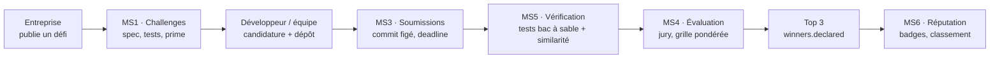
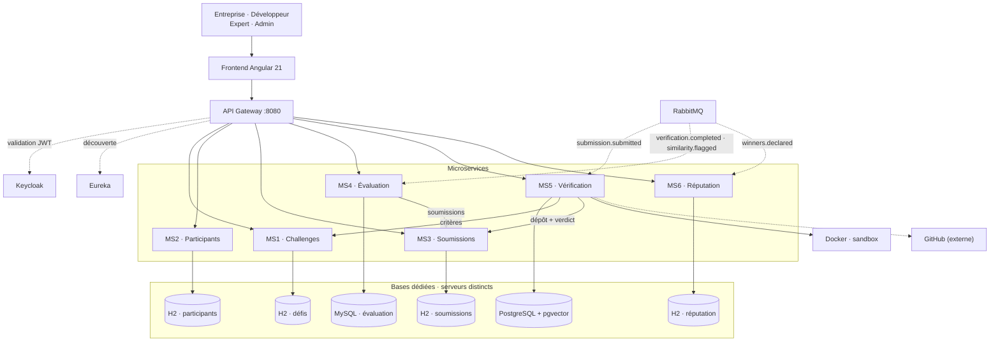
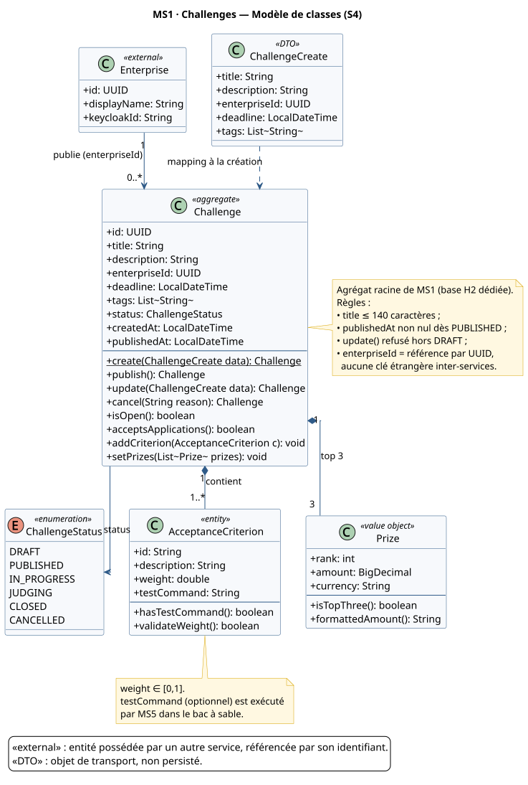
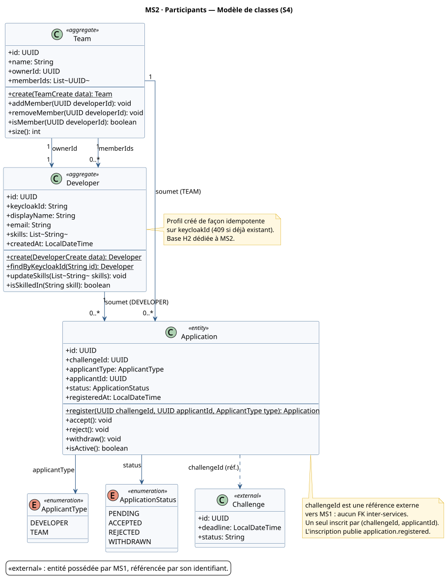
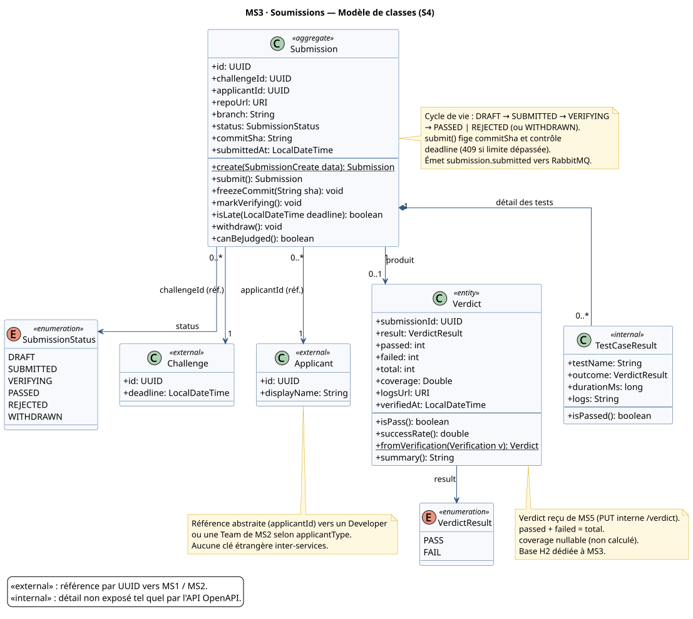
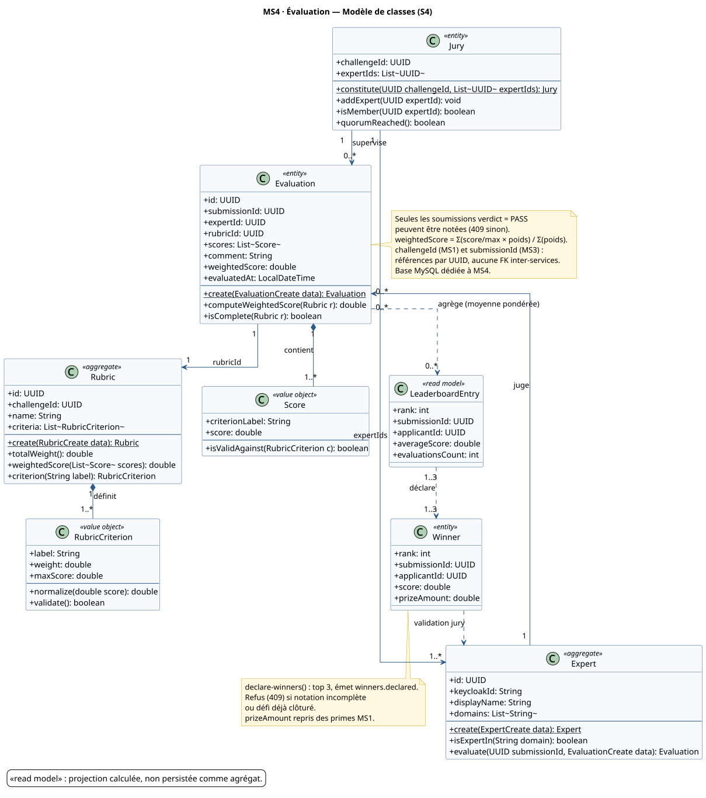
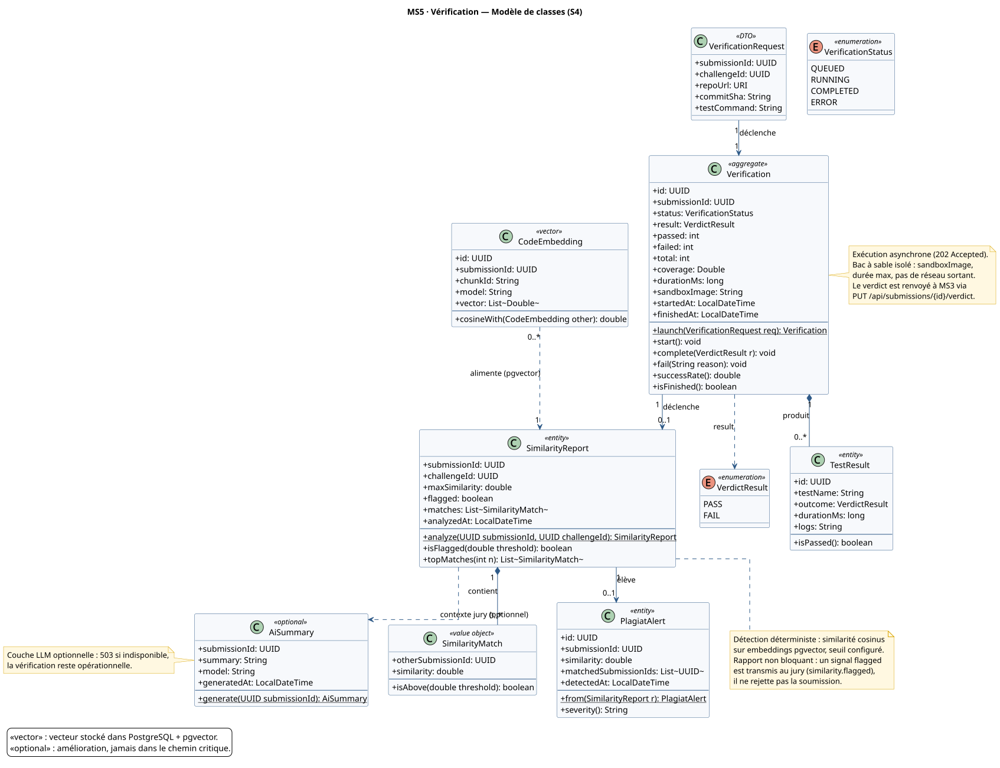
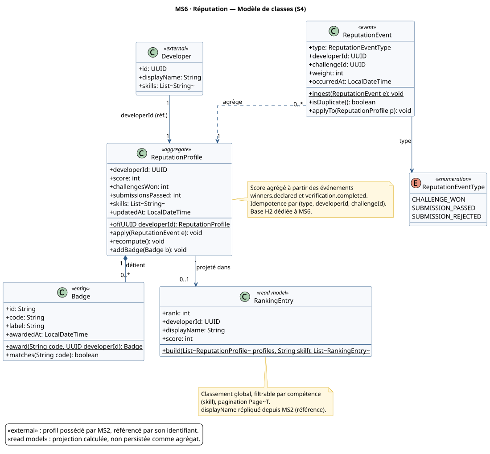
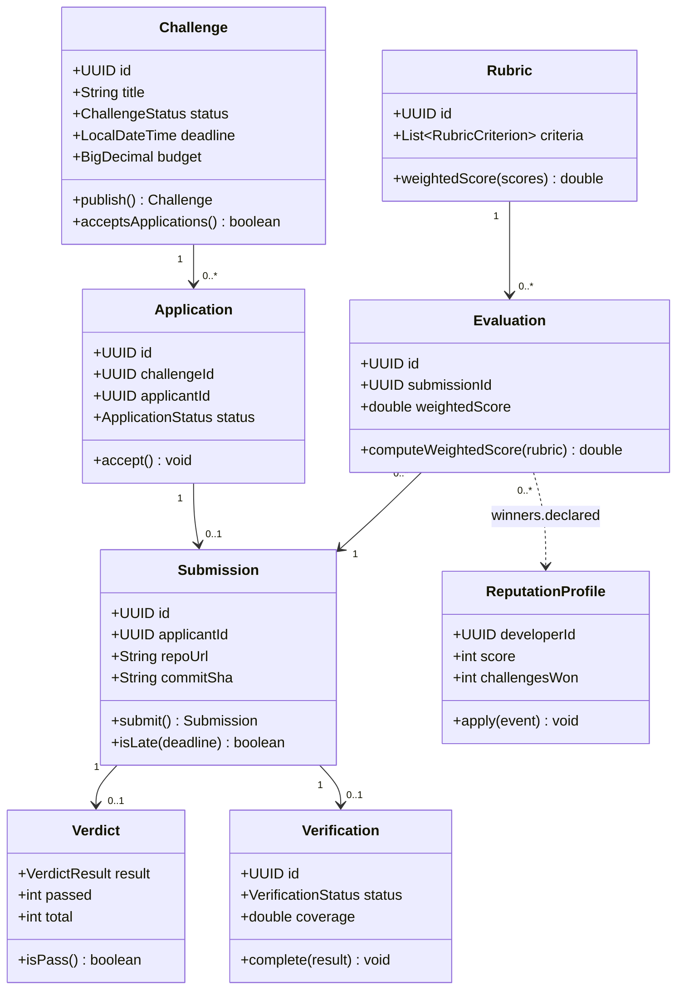
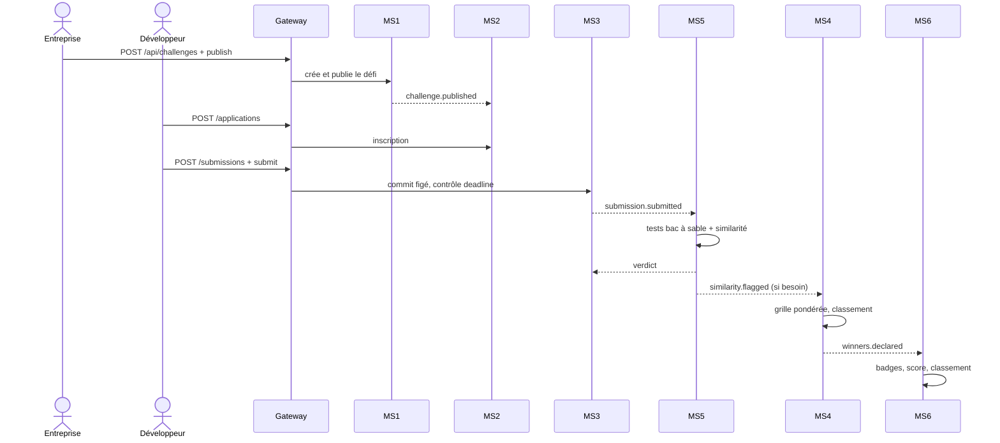

# Document technique — Arène

> [!abstract] En bref
> **Arène** est une plateforme de hackathons et de bounties : une entreprise publie un défi
> (cahier des charges, tests d'acceptation, prime), des développeurs soumettent un dépôt GitHub,
> un moteur vérifie le résultat, un jury note et désigne les gagnants.
> La conception S4 repose sur **6 microservices**, **39 endpoints OpenAPI gelés**, une base par
> service et une authentification **Keycloak / JWT**.

Ce document détaille les choix de conception présentés en séance 4. Il accompagne le
[deck de présentation](Presentation/Arene-S4-presentation-avec-diagrammes.pdf), les
[diagrammes UML](Diagrams/) et les [contrats d'API](../contracts/).

**Sommaire** : [[#1. Sujet et contexte|1 · Contexte]] · [[#2. Acteurs et périmètre fonctionnel|2 · Acteurs]] ·
[[#3. Architecture globale|3 · Architecture]] · [[#4. Découpage en microservices|4 · Microservices]] ·
[[#5. Modèles de données et diagrammes de classes|5 · Modèles de données]] ·
[[#6. Interactions entre services|6 · Interactions]] · [[#7. Sécurité et configuration|7 · Sécurité]] ·
[[#8. Contrats d'API|8 · API]] ·
[[#9. Stratégie de données|9 · Données]] · [[#10. Stack technique|10 · Stack]] ·
[[#11. Organisation, planning et risques|11 · Pilotage]] · [[#12. Décisions d'architecture|12 · ADR]] ·
[[#Annexes|Annexes]]

---

## 1. Sujet et contexte

### 1.1 Le besoin

Une entreprise a un besoin logiciel ponctuel, mais ne souhaite ni recruter une équipe dédiée ni
passer par un freelance au forfait. Le problème est double : **accéder à du sur-mesure à moindre
coût** et **disposer d'une preuve de qualité** avant de payer.

### 1.2 La réponse Arène

Arène transforme ce besoin en un **défi vérifié** : le commanditaire dépose un cahier des charges,
des tests d'acceptation et une prime ; la communauté répond ; une chaîne de vérification
déterministe puis une évaluation humaine produisent un classement et des gagnants.



### 1.3 Valeur métier

| Pour l'entreprise | Pour le développeur |
|---|---|
| Prime versée sur résultat vérifié, pas sur promesse. | Projets réels, évalués et valorisants. |
| Tests d'acceptation exécutés automatiquement. | Réputation vérifiable (badges, score, classement). |
| Jury humain pour la qualité qui ne se teste pas. | Commit figé : la preuve du travail est tracée. |

> [!tip] Important
> Le **coeur de la plateforme est déterministe** : l'exécution des tests et la détection de
> similarité sont reproductibles, auditables et indépendantes de tout service tiers.

---

## 2. Acteurs et périmètre fonctionnel

### 2.1 Acteurs

| Acteur | Responsabilité principale | Service d'entrée |
|---|---|---|
| **Entreprise** | Publie un défi, fixe budget/dates/tests, suit les résultats. | MS1 · Challenges |
| **Développeur / équipe** | S'inscrit, soumet un dépôt GitHub à un commit figé, est noté. | MS2, MS3 |
| **Expert** | Juge les soumissions retenues, attribue les scores et désigne les gagnants. | MS4 · Évaluation |
| **Admin** | Modération, litiges, gestion des comptes. | Gateway / tous |

### 2.2 Exigences fonctionnelles

| ID | Exigence | Acteur | Service |
|---|---|---|---|
| FR-01 | Créer, publier et clôturer un défi avec spécification et prime. | Entreprise | MS1 |
| FR-02 | Définir des critères d'acceptation et une commande de test. | Entreprise | MS1 → MS5 |
| FR-03 | Créer un profil développeur et une équipe. | Développeur | MS2 |
| FR-04 | S'inscrire à un défi avant la date limite. | Développeur | MS2 |
| FR-05 | Soumettre un dépôt public et figer le commit. | Développeur | MS3 |
| FR-06 | Exécuter les tests en bac à sable et produire un verdict. | Système | MS5 |
| FR-07 | Détecter une similarité suspecte entre soumissions. | Système | MS5 |
| FR-08 | Constituer un jury et une grille pondérée. | Entreprise / Admin | MS4 |
| FR-09 | Noter une soumission `PASS` et calculer un score pondéré. | Expert | MS4 |
| FR-10 | Classer les soumissions et désigner le top 3. | Expert / Système | MS4 |
| FR-11 | Consolider un profil de réputation, badges et classement. | Système | MS6 |
| FR-12 | Authentifier et autoriser chaque appel par rôle. | Tous | Keycloak + Gateway |

### 2.3 Périmètre MoSCoW

| Priorité | Contenu |
|---|---|
| **Must** | Publication, inscription, dépôt, tests d'acceptation, verdict, notation, classement, authentification, Gateway, Eureka. |
| **Should** | Anti-plagiat par similarité vectorielle, grilles pondérées multi-jurés, réputation et badges. |
| **Could** | Notifications par e-mail, export des résultats, journal d'audit détaillé. |
| **Won't (S4)** | Paiement en ligne, arbitrage juridique automatique, hébergement du code privé, application mobile native. |

> [!note] Nuance
> Les lignes *Should / Could / Won't* sont des **propositions de cadrage** cohérentes avec la
> présentation S4 ; le document source de cadrage détaillé est hors dépôt.

---

## 3. Architecture globale

Vue simplifiée par couches. Les flèches continues sont des appels REST / OpenFeign, les pointillés
des événements RabbitMQ ou des dépendances d'infrastructure (catalogue complet en
[[#6.2 Asynchrone — RabbitMQ / Spring Cloud Stream|§ 6.2]]). Chaque service possède sa propre base,
sur un **serveur distinct** : aucune clé étrangère inter-services.



### 3.1 Principes directeurs

1. **Une base par service** : aucun partage de schéma, aucune clé étrangère inter-services.
2. **Gateway comme point d'entrée unique** : `/api/**` routé par service, JWT vérifié en amont puis
   revalidé par chaque service.
3. **Services autonomes** : déploiement, base et cycle de vie indépendants ; Eureka pour la
   découverte, OpenFeign pour les appels synchrones.
4. **Orchestration par événements** : RabbitMQ / Spring Cloud Stream pour les effets de bord
   (publication, inscription, verdict, gagnants).
5. **Dégradation gracieuse** : si `ms5-verification` est arrêté, la plateforme reste utilisable
   avec une vérification manuelle.

---

## 4. Découpage en microservices

| Service | Port direct | Base dédiée | Responsabilité | Endpoints | Référent |
|---|---:|---|---|---:|---|
| **MS1 · Challenges** | 8081 | H2 | Défis, cycle de vie, critères, primes, catalogue | 9 | M1 |
| **MS2 · Participants** | 8082 | H2 | Développeurs, équipes, candidatures | 6 | M2 |
| **MS3 · Soumissions** | 8083 | H2 | Dépôt, commit figé, deadline, verdict | 6 | M3 |
| **MS4 · Évaluation** | 8084 | MySQL | Jury, grilles pondérées, scores, classement, gagnants | 8 | M4 |
| **MS5 · Vérification** | 8085 | PostgreSQL + pgvector | Bac à sable, anti-plagiat, IA d'appoint | 6 | Équipe |
| **MS6 · Réputation** | 8086 | H2 | Profils, badges, classements | 4 | M5 |

> [!info] Conventions de port
> La Gateway expose `http://localhost:8080/{service}/api/**` ; les ports 8081–8086 sont réservés
> aux accès directs en développement. **Total : 39 endpoints** gelés en S4.

---

## 5. Modèles de données et diagrammes de classes

> [!warning] Convention de lecture des diagrammes
> Les six diagrammes ci-dessous sont les **sources de vérité** du modèle de classes (fichiers
> PlantUML + SVG dans [`docs/Diagrams/`](Diagrams/)). Chaque classe expose désormais ses attributs
> **et** ses comportements, les énumérations, les multiplicités et des notes de règles métier.
> `<<external>>` = entité référencée par UUID uniquement ; `<<read model>>` = projection calculée.

### 5.1 MS1 · Challenges



| Classe | Attributs clés | Comportements |
|---|---|---|
| `Challenge` | `id`, `title`, `description`, `enterpriseId`, `deadline`, `tags`, `status`, `createdAt`, `publishedAt` | `create`, `publish`, `update`, `cancel`, `isOpen`, `acceptsApplications`, `addCriterion`, `setPrizes` |
| `AcceptanceCriterion` | `id`, `description`, `weight`, `testCommand` | `hasTestCommand`, `validateWeight` |
| `Prize` | `rank`, `amount`, `currency` | `isTopThree`, `formattedAmount` |
| `ChallengeCreate` (DTO) | `title`, `description`, `enterpriseId`, `deadline`, `tags` | — |
| `Enterprise` (externe) | `id`, `displayName`, `keycloakId` | — |
| `ChallengeStatus` (enum) | `DRAFT`, `PUBLISHED`, `IN_PROGRESS`, `JUDGING`, `CLOSED`, `CANCELLED` | — |

**Règles** : `title` ≤ 140 caractères ; `publishedAt` renseigné dès `PUBLISHED` ; `update()`
refusé hors `DRAFT` ; `weight ∈ [0,1]` ; `testCommand` exécuté par MS5 dans le bac à sable.

### 5.2 MS2 · Participants



| Classe | Attributs clés | Comportements |
|---|---|---|
| `Developer` | `id`, `keycloakId`, `displayName`, `email`, `skills`, `createdAt` | `create`, `findByKeycloakId`, `updateSkills`, `isSkilledIn` |
| `Team` | `id`, `name`, `ownerId`, `memberIds` | `create`, `addMember`, `removeMember`, `isMember`, `size` |
| `Application` | `id`, `challengeId`, `applicantType`, `applicantId`, `status`, `registeredAt` | `register`, `accept`, `reject`, `withdraw`, `isActive` |
| `ApplicantType` / `ApplicationStatus` (enums) | `DEVELOPER`, `TEAM` / `PENDING`, `ACCEPTED`, `REJECTED`, `WITHDRAWN` | — |

**Règles** : profil idempotent sur `keycloakId` (409 si déjà existant) ; unicité de
`(challengeId, applicantId)` ; `challengeId` est une référence externe vers MS1.

### 5.3 MS3 · Soumissions



| Classe | Attributs clés | Comportements |
|---|---|---|
| `Submission` | `id`, `challengeId`, `applicantId`, `repoUrl`, `branch`, `status`, `commitSha`, `submittedAt` | `create`, `submit`, `freezeCommit`, `markVerifying`, `isLate`, `withdraw`, `canBeJudged` |
| `Verdict` | `submissionId`, `result`, `passed`, `failed`, `total`, `coverage`, `logsUrl`, `verifiedAt` | `isPass`, `successRate`, `fromVerification`, `summary` |
| `TestCaseResult` (interne) | `testName`, `outcome`, `durationMs`, `logs` | `isPassed` |
| `SubmissionStatus` / `VerdictResult` (enums) | `DRAFT` → `SUBMITTED` → `VERIFYING` → `PASSED` / `REJECTED` / `WITHDRAWN` ; `PASS`, `FAIL` | — |

**Règles** : `submit()` fige `commitSha` et contrôle la date limite (409 si dépassée) ;
`passed + failed = total` ; `coverage` nullable ; le verdict est reçu de MS5 via un appel interne.

### 5.4 MS4 · Évaluation



| Classe | Attributs clés | Comportements |
|---|---|---|
| `Expert` | `id`, `keycloakId`, `displayName`, `domains` | `create`, `isExpertIn`, `evaluate` |
| `Jury` | `challengeId`, `expertIds` | `constitute`, `addExpert`, `isMember`, `quorumReached` |
| `Rubric` | `id`, `challengeId`, `name`, `criteria` | `create`, `totalWeight`, `weightedScore`, `criterion` |
| `RubricCriterion` | `label`, `weight`, `maxScore` | `normalize`, `validate` |
| `Score` | `criterionLabel`, `score` | `isValidAgainst` |
| `Evaluation` | `id`, `submissionId`, `expertId`, `rubricId`, `scores`, `comment`, `weightedScore`, `evaluatedAt` | `create`, `computeWeightedScore`, `isComplete` |
| `LeaderboardEntry` (read model) | `rank`, `submissionId`, `applicantId`, `averageScore`, `evaluationsCount` | — |
| `Winner` | `rank`, `submissionId`, `applicantId`, `score`, `prizeAmount` | — |

**Règle de calcul** : `weightedScore = Σ(score / maxScore × poids) / Σ(poids)`. Seules les
soumissions dont le verdict est `PASS` peuvent être notées (409 sinon). `declare-winners()` produit
le top 3 et émet `winners.declared` (409 si notation incomplète ou défi déjà clôturé).

### 5.5 MS5 · Vérification



| Classe | Attributs clés | Comportements |
|---|---|---|
| `VerificationRequest` (DTO) | `submissionId`, `challengeId`, `repoUrl`, `commitSha`, `testCommand` | — |
| `Verification` | `id`, `submissionId`, `status`, `result`, `passed`, `failed`, `total`, `coverage`, `durationMs`, `sandboxImage`, `startedAt`, `finishedAt` | `launch`, `start`, `complete`, `fail`, `successRate`, `isFinished` |
| `TestResult` | `id`, `testName`, `outcome`, `durationMs`, `logs` | `isPassed` |
| `CodeEmbedding` (pgvector) | `id`, `submissionId`, `chunkId`, `model`, `vector` | `cosineWith` |
| `SimilarityMatch` | `otherSubmissionId`, `similarity` | `isAbove` |
| `SimilarityReport` | `submissionId`, `challengeId`, `maxSimilarity`, `flagged`, `matches`, `analyzedAt` | `analyze`, `isFlagged`, `topMatches` |
| `PlagiatAlert` | `id`, `submissionId`, `similarity`, `matchedSubmissionIds`, `detectedAt` | `from`, `severity` |
| `AiSummary` (optionnel) | `submissionId`, `summary`, `model`, `generatedAt` | `generate` |

**Règles** : exécution asynchrone (`202 Accepted`), bac à sable isolé sans réseau sortant, verdict
renvoyé à MS3 ; similarité cosinus sur embeddings pgvector avec seuil configuré ; un rapport
`flagged` est **transmis au jury** (`similarity.flagged`) sans rejeter automatiquement la soumission.

#### IA d'appoint (optionnelle, propre à MS5)

> [!important] Ligne de défense
> « Nous utilisons le LLM là où il ajoute de la valeur (résumés, rédaction de tests), et des
> algorithmes déterministes ailleurs (exécution des tests, similarité). **Le verdict ne dépend
> jamais de l'IA.** »

| Capacité | Mécanisme | Entrée → Sortie | Validation humaine |
|---|---|---|---|
| Résumé de soumission pour le jury | LLM | Lit la soumission (MS3) → transmis au jury (MS4). | Facultative (jury) |
| Rédaction de tests d'acceptation | LLM | Brouillon de spec → déposé dans MS1. | **Oui, obligatoire** |
| Matching expert ↔ défi | Embeddings k-NN + LLM | Lit MS2 (experts) + MS1 (défis) → suggestion de jury. | **Oui** |
| Détection de conflit d'intérêt | Embeddings | Lit MS2 + MS4 → signalement au jury. | **Oui** |

**Garde-fous** : aucun appel LLM dans le chemin bloquant du verdict ; sorties tracées (`model`,
`generatedAt`) ; `503` si le service IA est indisponible. **Déchet** :
`docker compose stop ms5-verification` → la plateforme reste utilisable, la vérification devient
manuelle.

### 5.6 MS6 · Réputation



| Classe | Attributs clés | Comportements |
|---|---|---|
| `ReputationEvent` | `type`, `developerId`, `challengeId`, `weight`, `occurredAt` | `ingest`, `isDuplicate`, `applyTo` |
| `ReputationProfile` | `developerId`, `score`, `challengesWon`, `submissionsPassed`, `skills`, `updatedAt` | `of`, `apply`, `recompute`, `addBadge` |
| `Badge` | `id`, `code`, `label`, `awardedAt` | `award`, `matches` |
| `RankingEntry` (read model) | `rank`, `developerId`, `displayName`, `score` | `build` |
| `ReputationEventType` (enum) | `CHALLENGE_WON`, `SUBMISSION_PASSED`, `SUBMISSION_REJECTED` | — |

**Règles** : score agrégé à partir de `winners.declared` et `verification.completed` ; idempotence
par `(type, developerId, challengeId)` ; `displayName` répliqué depuis MS2 ; classement filtrable
par compétence et paginé.

### 5.7 Vue consolidée du domaine



---

## 6. Interactions entre services

### 6.1 Synchrone — REST / OpenFeign via Gateway

| Appel | Producteur → Consommateur | Objet |
|---|---|---|
| `GET /ms1/api/challenges/{id}/acceptance-criteria` | MS5 → MS1 | Récupérer la spec de tests à exécuter. |
| `GET /ms3/api/submissions/{id}` | MS5 → MS3 | Métadonnées du dépôt (URL, commit, branche). |
| `PUT /ms3/api/submissions/{id}/verdict` | MS5 → MS3 | Déposer le résultat de vérification. |
| `GET /ms3/api/submissions?challengeId=` | MS4 → MS3 | Lister les soumissions à noter. |
| `GET /ms2/api/...` | MS4 → MS2 | Vérifier l'identité des experts / candidats. |
| `GET /ms6/api/developers/{id}/reputation` | Front → MS6 | Afficher le profil de réputation. |

Découverte des instances via **Eureka** ; les appels service-à-service passent par **OpenFeign**.

### 6.2 Asynchrone — RabbitMQ / Spring Cloud Stream

| Événement | Producteur | Consommateurs | Effet |
|---|---|---|---|
| `challenge.published` | MS1 | MS2, MS5 | Ouverture des candidatures, préparation de la vérification. |
| `application.registered` | MS2 | MS1, MS6 | Notification au commanditaire, mise à jour réputation. |
| `submission.submitted` | MS3 | MS5 | Lancement de la vérification (tests + similarité). |
| `verification.completed` | MS5 | MS3, MS4, MS6 | Verdict, éligibilité à la notation, points réputation. |
| `similarity.flagged` | MS5 | MS4 | Alerte visible par le jury avant notation. |
| `judging.completed` | MS4 | MS3, MS6 | Clôture de la phase de notation. |
| `winners.declared` | MS4 | MS1, MS6 | Clôture du défi, badges et score. |

> [!note] Catalogue logique
> Ces noms sont cohérents avec les résumés OpenAPI et le diagramme global. Le catalogue
> d'événements définitif figure dans le document source `Arène-contrats-et-deploiement.md`
> (hors dépôt).[^1]

### 6.3 Scénario bout en bout



---

## 7. Sécurité et configuration

### 7.1 Authentification

**Keycloak** est une infrastructure (pas un microservice applicatif). Le frontend obtient un jeton
**OIDC / JWT**, l'envoie en `Authorization: Bearer <JWT>` ; la Gateway le valide, puis **chaque
service revalide le jeton** et en extrait les rôles. Aucun service ne stocke de mot de passe : seuls
des identifiants `keycloakId` sont répliqués (MS2, MS4).

### 7.2 Matrice des droits

| Action | Entreprise | Développeur | Expert | Admin |
|---|:---:|:---:|:---:|:---:|
| Publier / clôturer un défi | ✅ | ❌ | ❌ | ✅ |
| S'inscrire à un défi | ❌ | ✅ | ❌ | ✅ |
| Soumettre un dépôt | ❌ | ✅ | ❌ | ✅ |
| Lire les critères / le verdict | ✅ | ✅ | ✅ | ✅ |
| Noter une soumission | ❌ | ❌ | ✅ | ✅ |
| Déclarer les gagnants | ❌ | ❌ | ✅ | ✅ |
| Modérer comptes et litiges | ❌ | ❌ | ❌ | ✅ |

### 7.3 Configuration transverse

| Élément | Valeur / convention |
|---|---|
| Base path | `/api` (préfixe Gateway `/{service}`) |
| Format | JSON ; `Content-Type: application/json` |
| Sécurité | `Authorization: Bearer <JWT>` (OpenAPI `bearerAuth`) |
| Erreurs | Enveloppe `ErrorResponse` : `timestamp`, `status`, `error`, `message`, `path` |
| Pagination | `Page<T>` : `content`, `totalElements`, `totalPages`, `number`, `size` |
| Déploiement | `docker-compose.yml` : Gateway + 6 services + Keycloak + Eureka + RabbitMQ + bases |

---

## 8. Contrats d'API

> [!success] Contrats gelés en S4
> 6 fichiers OpenAPI 3.0.3 dans [`contracts/`](../contracts/), **39 endpoints** au total. Chaque
> membre peut développer son service indépendamment avec des mocks avant l'intégration S5–S9.

| Service | Fichier | Endpoints |
|---|---|---:|
| MS1 · Challenges | [`ms1-challenges.openapi.yaml`](../contracts/ms1-challenges.openapi.yaml) | 9 |
| MS2 · Participants | [`ms2-participants.openapi.yaml`](../contracts/ms2-participants.openapi.yaml) | 6 |
| MS3 · Soumissions | [`ms3-submissions.openapi.yaml`](../contracts/ms3-submissions.openapi.yaml) | 6 |
| MS4 · Évaluation | [`ms4-evaluation.openapi.yaml`](../contracts/ms4-evaluation.openapi.yaml) | 8 |
| MS5 · Vérification | [`ms5-verification.openapi.yaml`](../contracts/ms5-verification.openapi.yaml) | 6 |
| MS6 · Réputation | [`ms6-reputation.openapi.yaml`](../contracts/ms6-reputation.openapi.yaml) | 4 |

<details>
<summary><strong>Détail des 39 endpoints</strong> (cliquer pour déplier)</summary>

| Service | Routes |
|---|---|
| MS1 | `POST/GET /api/challenges` · `GET/PUT /api/challenges/{id}` · `POST /api/challenges/{id}/publish` · `GET/PUT /api/challenges/{id}/acceptance-criteria` · `GET/PUT /api/challenges/{id}/prizes` |
| MS2 | `POST /api/developers` · `GET /api/developers/{id}` · `POST /api/teams` · `GET /api/teams/{id}` · `POST/GET /api/challenges/{challengeId}/applications` |
| MS3 | `POST/GET /api/submissions` · `GET /api/submissions/{id}` · `POST /api/submissions/{id}/submit` · `GET/PUT /api/submissions/{id}/verdict` |
| MS4 | `POST /api/experts` · `POST/GET /api/challenges/{challengeId}/jury` · `POST/GET /api/rubrics` · `POST /api/evaluations` · `GET /api/challenges/{challengeId}/leaderboard` · `POST /api/challenges/{challengeId}/declare-winners` |
| MS5 | `POST /api/verifications` · `GET /api/verifications/{id}` · `GET /api/verifications/{id}/logs` · `POST /api/similarity/analyze` · `GET /api/similarity/{submissionId}` · `POST /api/ai/summarize/{submissionId}` |
| MS6 | `GET /api/developers/{id}/reputation` · `GET /api/developers/{id}/badges` · `GET /api/rankings` · `POST /api/reputation/events` |

</details>

> [!example]- Exemple de convention d'erreur
> ```json
> {
>   "timestamp": "2026-11-19T10:15:30Z",
>   "status": 409,
>   "error": "Conflict",
>   "message": "Date limite dépassée ou soumission déjà figée",
>   "path": "/api/submissions/3f2a.../submit"
> }
> ```

---

## 9. Stratégie de données

| Service | Moteur | Raison du choix |
|---|---|---|
| MS1 · Challenges | H2 | Défis et catalogue, faible volume, démarrage rapide. |
| MS2 · Participants | H2 | Profils et candidatures autonomes. |
| MS3 · Soumissions | H2 | Métadonnées de dépôt et verdicts. |
| MS4 · Évaluation | MySQL | Scores, grilles et classements relationnels. |
| MS5 · Vérification | PostgreSQL + pgvector | Vecteurs d'embeddings et recherche de similarité. |
| MS6 · Réputation | H2 | Profils agrégés, badges, classements calculés. |

**Règles de cohérence** :

- **Aucune clé étrangère inter-services** : les références sont des UUID (`challengeId`,
  `applicantId`, `expertId`, `submissionId`, `developerId`).
- **Cohérence à terme** : les effets entre services passent par RabbitMQ ; chaque consommateur est
  idempotent (ex. `ReputationEvent.isDuplicate()`).
- **Données répliquées minimales** : `displayName` et `skills` dans MS6, `enterpriseId` dans MS1.
- **Projection, non source de vérité** : `LeaderboardEntry` et `RankingEntry` sont calculés, jamais
  modifiés directement.

> [!warning] Attention
> Une mise à jour dans MS1 n'est pas atomique avec MS2/MS5. Les handlers d'événements doivent
> tolérer les doublons et les arrivées hors ordre.

---

## 10. Stack technique

| Couche | Technologies |
|---|---|
| Backend | Java 21, Spring Boot, Spring Cloud Gateway, Eureka, OpenFeign, Spring Cloud Stream |
| Sécurité | Keycloak (OIDC / JWT), rôles applicatifs, validateur JWT par service |
| Messagerie | RabbitMQ (échanges de type topic / fanout selon l'événement) |
| Données | H2, MySQL, PostgreSQL + pgvector (recherche de similarité) |
| Vérification | Bac à sable Docker isolé, tests d'acceptation, similarité cosinus |
| Frontend | Angular 21, Node 22 |
| Livraison | Docker, Docker Compose, GitHub Projects, branches Git dédiées |

---

## 11. Organisation, planning et risques

### 11.1 Répartition des tâches

| Référent | Périmètre |
|---|---|
| M1 | MS1 · Challenges |
| M2 | MS2 · Participants |
| M3 | MS3 · Soumissions |
| M4 | MS4 · Évaluation |
| M5 | MS6 · Réputation |
| Équipe | MS5 · Vérification + infrastructure + frontend Angular |

### 11.2 Planning S4 → S10

| Sprint | Jalon |
|---|---|
| S4 | Conception validée, contrats OpenAPI gelés, diagrammes UML, deck. |
| S5 | Squelettes de services, Gateway, Eureka, Keycloak, `docker-compose.yml`. |
| S6 | MS1 + MS2 : défis, profils, candidatures. |
| S7 | MS3 + MS5 : dépôt, commit figé, exécution des tests, verdict. |
| S8 | MS4 : jury, grilles, notation, classement, gagnants. |
| S9 | MS6 + frontend : réputation, intégration end-to-end. |
| S10 | Durcissement, tests, démonstration finale. |

### 11.3 Risques et mitigations

| Risque | Impact | Mitigation |
|---|---|---|
| Retrouver un contrat d'API en cours de route | Élevé | Contrats gelés en S4, revue obligatoire avant toute évolution. |
| Exécution de code non fiable | Critique | Bac à sable Docker, pas de réseau sortant, timeout, commit figé. |
| Faux positifs d'anti-plagiat | Moyen | Seuil configuré, signalement au jury, jamais de rejet automatique. |
| Désynchronisation des événements | Moyen | Consommateurs idempotents, réconciliation via les API de lecture. |

### 11.4 Pilotage Git

GitHub Projects avec milestones par sprint, étiquettes (epics) par service, branches
`feature/MSx-<sujet>`, revue de code et merge vers `main` en fin de sprint.

---

## 12. Décisions d'architecture

| ID | Décision | Justification |
|---|---|---|
| ADR-001 | Une base par service, zéro FK inter-services. | Autonomie de déploiement et d'évolution des schémas. |
| ADR-002 | Gateway unique + Eureka + OpenFeign. | Point d'entrée homogène, découverte dynamique, traçabilité. |
| ADR-003 | Keycloak en infrastructure, pas en microservice applicatif. | JWT standard, réutilisable, aucun mot de passe stocké. |
| ADR-004 | RabbitMQ pour les effets de bord. | Découplage temporel, résilience, idempotence. |
| ADR-005 | Commit SHA figé à la soumission. | Reproductibilité des tests et preuve anti-triche. |
| ADR-006 | Verdict déterministe, hors chemin optionnel. | Résultat auditable, reproductible et toujours disponible. |

---

## 13. Conclusion

La conception validée en S4 est **cohérente et complète au niveau contrat** : six services
autonomes, 39 endpoints gelés, modèles de classes développés (attributs, comportements, règles),
communications sync/async définies et sécurité centralisée.
L'étape suivante est l'implémentation incrémentale S5 → S10, service par service, avec les mocks
OpenAPI pour travailler en parallèle.

---

## Annexes

### Glossaire

| Terme | Définition |
|---|---|
| **Défi** | Appel à projet publié par une entreprise, avec spec, tests et prime. |
| **Critère d'acceptation** | Test ou exigence vérifiable, éventuellement associé à une commande. |
| **Soumission** | Dépôt GitHub public lié à un défi, figé à un commit. |
| **Verdict** | Résultat de la vérification automatique (`PASS` / `FAIL`). |
| **Grille (rubric)** | Ensemble de critères pondérés utilisés par le jury. |
| **Leaderboard** | Classement calculé des soumissions d'un défi. |
| **Réputation** | Score agrégé, badges et classement d'un développeur. |

### Liens utiles

- [Diagrammes PlantUML et SVG](Diagrams/) — global, cas d'utilisation, séquence, classes, similarité.
- [Contrats OpenAPI](../contracts/) — 6 spécifications gelées.
- [Présentation S4](Presentation/Arene-S4-presentation-avec-diagrammes.pdf) — deck de validation.
- [README du dépôt](../README.md) — vue d'ensemble du projet.

[^1]: Le document source `Arène-contrats-et-deploiement.md` (catalogue d'événements et
    `docker-compose.yml` détaillé) est hors dépôt ; les informations reprises ici sont celles des
    contrats OpenAPI et du diagramme global.
