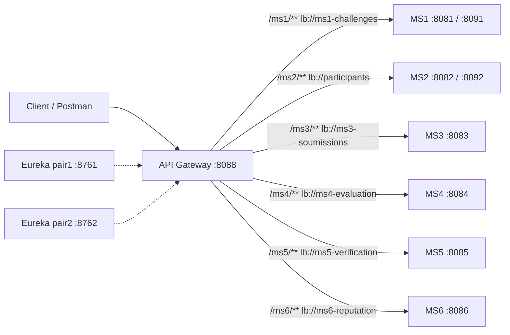
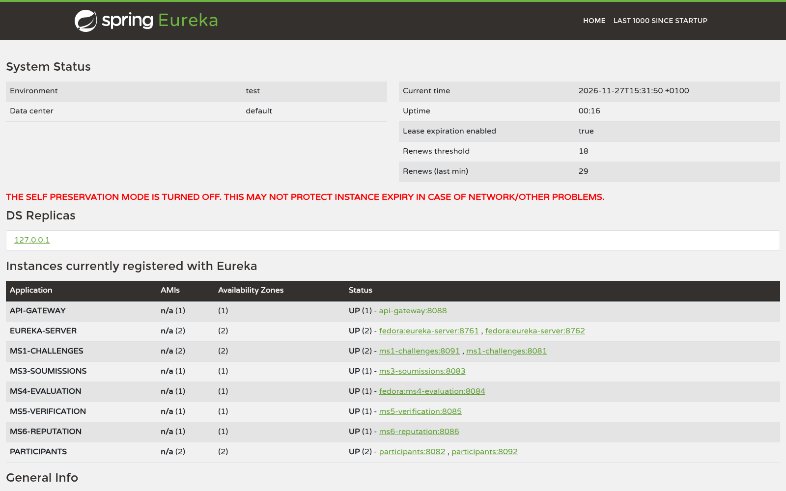
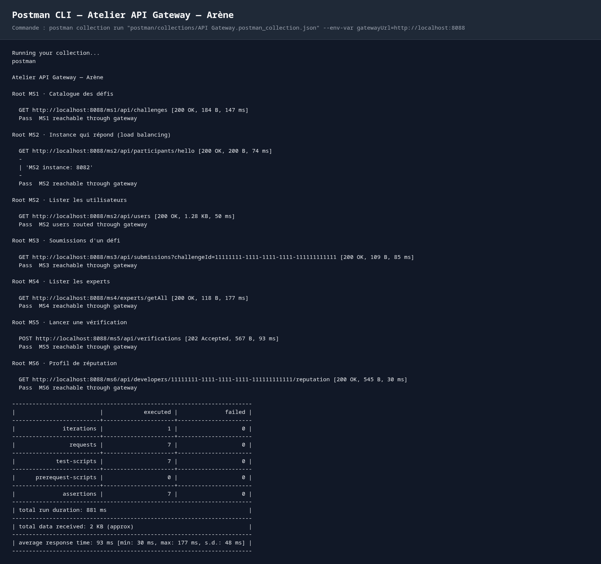
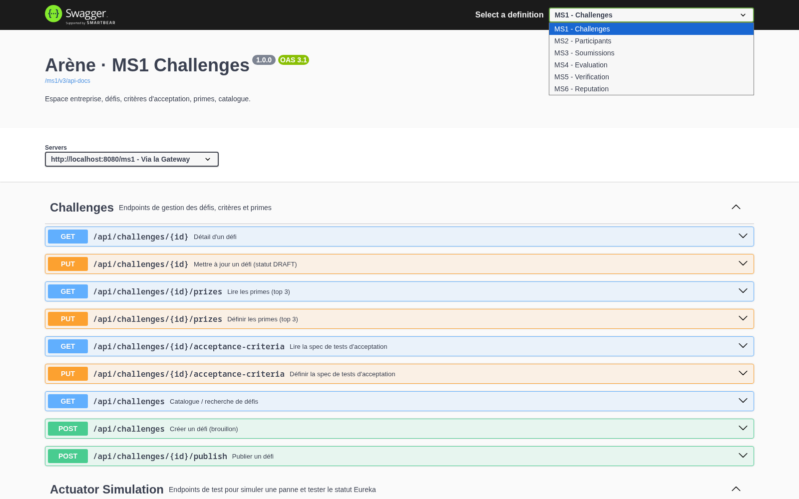

# API Gateway — Arène

> [!abstract] Résultat
> Une passerelle Spring Cloud Gateway est le **point d’accès unique** des six microservices Arène.
> Elle est enregistrée dans Eureka, agrège les six specs OpenAPI dans un portail Swagger unique,
> applique trois stratégies de load balancing isolées par service, et protège MS6 par un circuit breaker.

## 1. Livrables couverts

- [x] Module `Backend/api-gateway` (Spring Boot 3.5.0 / Spring Cloud 2025.0.0 / Java 17)
- [x] Enregistrement de la Gateway dans Eureka (port **8088** pendant les tests, **8080** par défaut)
- [x] Routage dynamique `lb://` vers les six services via Eureka
- [x] Routage statique alternatif via le profil `static`
- [x] Logs DEBUG : route, service, algorithme et instance amont sélectionnée
- [x] Postman : une requête testée par microservice, toujours via la Gateway
- [x] Capture Eureka avec les numéros de port
- [x] Portail Swagger unifié avec les six microservices
- [x] Random sur MS2 uniquement ; Header Hash sur MS1 ; Round Robin par défaut ailleurs
- [x] Circuit breaker Resilience4j sur MS6 avec `fallbackUri=forward:/fallback/ms`

## 2. Point d’entrée unique



> [!note] Conventions de prefix
> Chaque route consomme un prefix `/msN`, le retire avec `StripPrefix=1`, puis transmet le chemin restant au microservice.
> Le même prefix expose `/msN/v3/api-docs` pour le portail Swagger.

| Prefix Gateway | `serviceId` Eureka | Ports directs | Algorithme | Requête Postman de référence |
|---|---|---|---|---|
| `/ms1/**` | `ms1-challenges` | `8081`, `8091` | **Header Hash** (`X-Route-Key`) | `GET /ms1/api/challenges` |
| `/ms2/**` | `participants` | `8082`, `8092` | **Random** | `GET /ms2/api/participants/hello` |
| `/ms3/**` | `ms3-soumissions` | `8083` | Round Robin (défaut) | `GET /ms3/api/submissions?challengeId=…` |
| `/ms4/**` | `ms4-evaluation` | `8084` | Round Robin (défaut) | `GET /ms4/experts/getAll` |
| `/ms5/**` | `ms5-verification` | `8085` | Round Robin (défaut) | `POST /ms5/api/verifications` |
| `/ms6/**` | `ms6-reputation` | `8086` | Round Robin (défaut) | `GET /ms6/api/developers/{id}/reputation` |

## 3. Démarrage

### Mode dynamique (Eureka)

```bash
# Depuis la racine du dépôt
mvn -q -DskipTests package
java -jar Backend/api-gateway/target/api-gateway-0.0.1-SNAPSHOT.jar
```

Par défaut la Gateway écoute sur `8080`. Pendant la vérification locale, Jenkins occupait ce port :

```bash
GATEWAY_PORT=8088 java -jar Backend/api-gateway/target/api-gateway-0.0.1-SNAPSHOT.jar
```

Les deux pairs Eureka sont configurés dans `application.properties` :

```properties
eureka.client.service-url.defaultZone=http://localhost:8761/eureka/,http://localhost:8762/eureka/
```

### Mode statique (sans Eureka)

```bash
java -jar Backend/api-gateway/target/api-gateway-0.0.1-SNAPSHOT.jar --spring.profiles.active=static
```

Le profil `static` remplace les URI `lb://…` par des URI directes `http://localhost:808N`.

## 4. Enregistrement dans Eureka — capture

La Gateway apparaît bien comme `api-gateway:8088` dans Eureka, avec les deux instances MS1 et les deux instances MS2.



Extrait de `docs/evidence/load-balancing.txt` :

```text
- api-gateway
    <instanceId>api-gateway:8088</instanceId>
    <port enabled="true">8088</port>
- ms1-challenges
    <instanceId>ms1-challenges:8091</instanceId>
    <port enabled="true">8091</port>
    <instanceId>ms1-challenges:8081</instanceId>
    <port enabled="true">8081</port>
- participants
    <instanceId>participants:8082</instanceId>
    <port enabled="true">8082</port>
    <instanceId>participants:8092</instanceId>
    <port enabled="true">8092</port>
```

> [!tip] Vérification HTTP
> `GET http://localhost:8088/actuator/health` retourne `200` et expose le discovery composite avec les huit applications enregistrées.

## 5. Routage et traçabilité

`RoutingAuditFilter` s’exécute juste après `ReactiveLoadBalancerClientFilter` (ordre `10150 + 1`) et journalise la décision réelle :

```text
Routing decision: route=participants, service=PARTICIPANTS, algorithm=Random, upstream=172.14.15.191:8082
Routing decision: route=ms1-challenges, service=MS1-CHALLENGES, algorithm=HeaderHash(X-Route-Key), upstream=172.14.15.191:8091
Routing decision: route=ms3-soumissions, service=MS3-SOUMISSIONS, algorithm=RoundRobin(default), upstream=172.14.15.191:8083
```

Les logs sont activés dans `application.properties` :

```properties
logging.level.org.springframework.cloud.gateway=DEBUG
logging.level.org.springframework.cloud.loadbalancer=DEBUG
logging.level.tn.arene.gateway=DEBUG
logging.level.tn.arene.loadbalancer=DEBUG
```

## 6. Algorithmes de load balancing

> [!warning] Isolation des contextes
> Les configurations personnalisées sont dans `tn.arene.loadbalancer`, **hors du package scanné** `tn.arene.gateway`.
> Elles sont chargées uniquement dans le contexte enfant créé par `@LoadBalancerClient`.
> Cela évite qu’un bean `ReactorLoadBalancer` personnalisé soit partagé par toutes les routes.

| Service | Algorithme | Pourquoi | Preuve |
|---|---|---|---|
| MS2 `participants` | `RandomLoadBalancer` | Correspond au « Candidat » de l’atelier ; deux instances actives | 6 appels sur `8082`, 6 sur `8092` |
| MS1 `ms1-challenges` | `Hash(X-Route-Key)` | Deuxième algorithme, ni Round Robin ni Random ; routage sticky déterministe | `alice` → `8081`, `bob` → `8091` |
| MS3/MS4/MS5/MS6 | Round Robin (défaut Spring Cloud) | Aucune configuration spécifique | `algorithm=RoundRobin(default)` dans les logs |

Test MS1 :

```bash
curl -H 'X-Route-Key: alice' http://localhost:8088/ms1/api/challenges
curl -H 'X-Route-Key: bob'   http://localhost:8088/ms1/api/challenges
```

Test MS2 :

```bash
for i in $(seq 1 12); do
  curl -s http://localhost:8088/ms2/api/participants/hello | grep -o '"port":"[0-9]*"'
done | sort | uniq -c
#       6 "port":"8082"
#       6 "port":"8092"
```

Preuve complète : [docs/evidence/load-balancing.txt](evidence/load-balancing.txt)

## 7. Circuit breaker — bonus demandé

Dépendance ajoutée à `Backend/api-gateway/pom.xml` :

```xml
<dependency>
  <groupId>org.springframework.cloud</groupId>
  <artifactId>spring-cloud-starter-circuitbreaker-reactor-resilience4j</artifactId>
</dependency>
```

Filtre sur la route MS6 :

```properties
spring.cloud.gateway.server.webflux.routes[5].filters[1].name=CircuitBreaker
spring.cloud.gateway.server.webflux.routes[5].filters[1].args.name=ms6CircuitBreaker
spring.cloud.gateway.server.webflux.routes[5].filters[1].args.fallbackUri=forward:/fallback/ms
```

`FallbackController` expose `GET /fallback/ms` et renvoie un JSON `SERVICE_UNAVAILABLE` avec l’identifiant de route.

### Scénario vérifié

1. MS6 répond normalement : circuit `CLOSED`.
2. Arrêt de MS6 (`kill $(cat .../ms6.pid)`).
3. Deux appels à `GET /ms6/api/developers/{id}/reputation` → réponse JSON du fallback.
4. `GET /actuator/circuitbreakers` → `state: OPEN`, `failedCalls: 1`, `notPermittedCalls: 1`.
5. Redémarrage de MS6, transition half-open puis nouveau succès → `state: CLOSED`.

```json
{
  "status": "SERVICE_UNAVAILABLE",
  "message": "Le microservice est momentanément indisponible (circuit breaker ouvert).",
  "route": "ms6-reputation",
  "fallbackUri": "/fallback/ms"
}
```

Preuve complète : [docs/evidence/circuit-breaker.txt](evidence/circuit-breaker.txt)

## 8. Test Postman

Collection exportée : [`postman/collections/API Gateway.postman_collection.json`](../postman/collections/API%20Gateway.postman_collection.json)

```bash
postman collection run 'postman/collections/API Gateway.postman_collection.json' \
  --env-var gatewayUrl=http://localhost:8088
```

Résultat : **7 requêtes exécutées, 7 assertions réussies, 0 échec** (MS1, MS2 ×2, MS3, MS4, MS5, MS6).



Sortie textuelle : [docs/evidence/postman-run.txt](evidence/postman-run.txt)

## 9. Portail Swagger unifié

URL : **http://localhost:8088/swagger-ui.html**

Les six définitions sont déclarées via `springdoc.swagger-ui.urls[*]` dans `application.properties` et accessibles à travers les prefixes de la Gateway :

- `/ms1/v3/api-docs`
- `/ms2/v3/api-docs`
- `/ms3/v3/api-docs`
- `/ms4/v3/api-docs`
- `/ms5/v3/api-docs`
- `/ms6/v3/api-docs`



## 10. Tests et fichiers modifiés

```bash
cd Backend/api-gateway
mvn -q test
```

Les tests vérifient :

- le chargement du contexte ;
- les six routes `lb://` et leurs prefixes ;
- le filtre CircuitBreaker sur MS6 ;
- le cadrage des deux configurations de load balancing ;
- l’absence de `ReactorLoadBalancer` dans le contexte principal.

Fichiers principaux :

- `Backend/api-gateway/pom.xml`
- `Backend/api-gateway/src/main/resources/application.properties`
- `Backend/api-gateway/src/main/resources/application-static.properties`
- `Backend/api-gateway/src/main/java/tn/arene/gateway/ApiGatewayApplication.java`
- `Backend/api-gateway/src/main/java/tn/arene/gateway/filter/RoutingAuditFilter.java`
- `Backend/api-gateway/src/main/java/tn/arene/gateway/fallback/FallbackController.java`
- `Backend/api-gateway/src/main/java/tn/arene/loadbalancer/ParticipantLoadBalancerConfig.java`
- `Backend/api-gateway/src/main/java/tn/arene/loadbalancer/ChallengeHashLoadBalancer.java`
- `Backend/api-gateway/src/main/java/tn/arene/loadbalancer/ChallengeHashLoadBalancerConfig.java`
- `postman/collections/API Gateway.postman_collection.json`
- `scripts/start-all.sh`, `scripts/start-all.ps1`
- `README.md`, `Backend/README.md`

> [!success] Conclusion
> Toutes les requêtes passent par le port de la Gateway, y compris les specs OpenAPI.
> Les trois stratégies de répartition sont isolées et prouvées par les logs, et le circuit breaker bascule bien sur `/fallback/ms` lorsque MS6 est arrêté.
