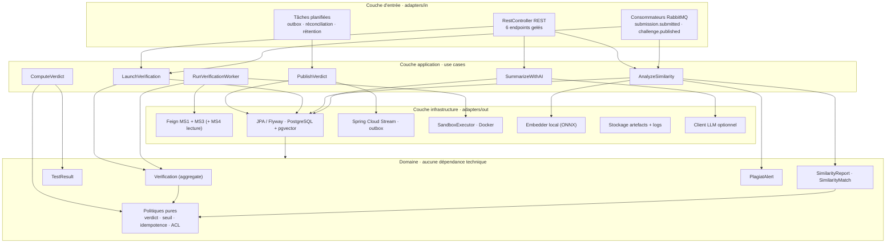
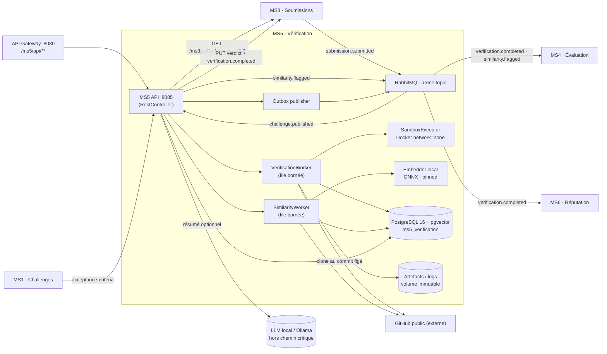
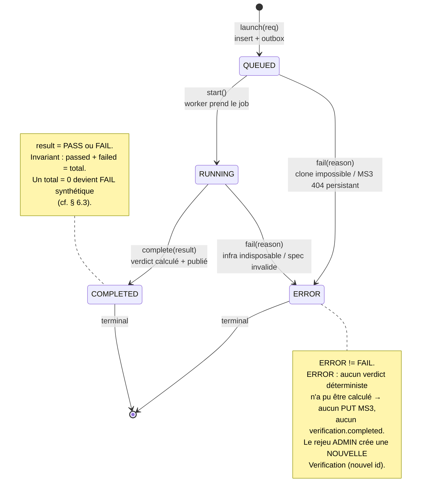
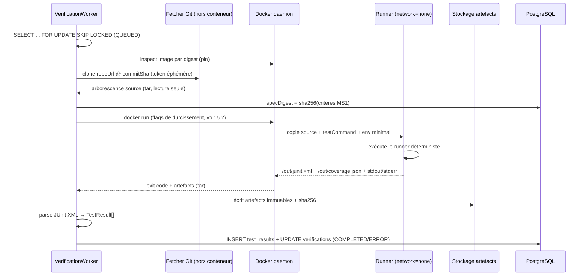
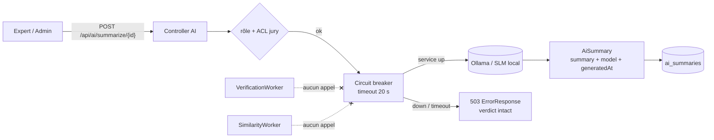
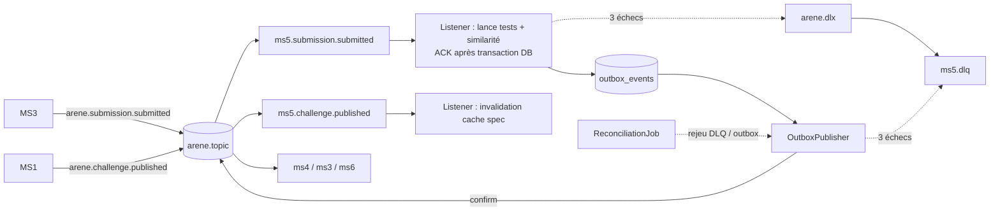

# Plan d'implémentation — MS5 Vérification

> [!abstract] En bref
> Ce plan descend la conception validée en S4 ([[Document-technique]], §§ 3–12) en un plan
> **buildable** pour le seul service **MS5 · Vérification** (port **8085**, 6 endpoints gelés,
> PostgreSQL + pgvector). Il couvre l'architecture interne, la machine à états, le schéma de
> données, le bac à sable, le calcul déterministe du verdict, le pipeline de similarité, la couche
> IA optionnelle, les intégrations REST/RabbitMQ, la sécurité, la configuration, l'observabilité,
> les tests et le calendrier S5 → S10.
> **Aucun contrat OpenAPI n'est modifié** : [`contracts/ms5-verification.openapi.yaml`](contracts/ms5-verification.openapi.yaml)
> et les trois contrats synchrones demeurent gelés. Les divergences trouvées sont consignées en
> [[#13. Écarts à trancher|§ 13]] avec une résolution recommandée.

**Sources** : [[Document-technique]] ·
[`contracts/ms5-verification.openapi.yaml`](contracts/ms5-verification.openapi.yaml) ·
[`contracts/ms3-submissions.openapi.yaml`](contracts/ms3-submissions.openapi.yaml) ·
[`contracts/ms1-challenges.openapi.yaml`](contracts/ms1-challenges.openapi.yaml) ·
[`contracts/ms4-evaluation.openapi.yaml`](contracts/ms4-evaluation.openapi.yaml) ·
[`Diagrams/Verification/`](Diagrams/Verification/) ·
[`Diagrams/Global/global-architecture.puml`](Diagrams/Global/global-architecture.puml).

**Sommaire** : [[#1. Objectifs et non-objectifs|1 · Objectifs]] ·
[[#2. Architecture des composants|2 · Composants]] ·
[[#3. Machine à états|3 · États]] ·
[[#4. Schéma PostgreSQL + pgvector|4 · Données]] ·
[[#5. Exécution en bac à sable|5 · Bac à sable]] ·
[[#6. Runner déterministe et verdict|6 · Verdict]] ·
[[#7. Pipeline de similarité|7 · Similarité]] ·
[[#8. IA optionnelle hors chemin critique|8 · IA]] ·
[[#9. Mapping des 6 endpoints gelés|9 · API]] ·
[[#10. Intégrations RabbitMQ|10 · Événements]] ·
[[#11. Sécurité et configuration|11 · Sécurité / config]] ·
[[#12. Observabilité et tests|12 · Observabilité / tests]] ·
[[#13. Écarts à trancher|13 · Écarts]] ·
[[#14. Décisions & contraintes (ADR)|14 · ADR]] ·
[[#15. Planning S5–S10|15 · Planning]] ·
[[#16. Risques et mitigations|16 · Risques]]

---

## 1. Objectifs et non-objectifs

### 1.1 Objectifs

| ID | Objectif | Critère de réussite |
|---|---|---|
| G-01 | Exécuter les tests d'acceptation d'une soumission à un **commit figé**. | Le commit exécuté est identique au `commitSha` reçu de MS3 ; toute exécution reproductible avec la même image et la même spec. |
| G-02 | Produire un verdict **`PASS`/`FAIL` déterministe**, indépendant de l'IA. | Deux exécutions avec les mêmes intrants donnent le même `result`, `passed`, `failed`, `total`. |
| G-03 | Restituer le verdict à MS3 et publier les effets de bord. | `PUT /ms3/api/submissions/{id}/verdict` + `verification.completed`, avec rejeux idempotents. |
| G-04 | Détecter une similarité suspecte par vecteurs. | Rapport `SimilarityReport` calculé sur pgvector, livré avec un seuil calibré, **jamais** de rejet automatique. |
| G-05 | Fournir un résumé IA optionnel au jury. | `503` rapide si le service IA est absent ; aucun appel IA dans le chemin du verdict. |
| G-06 | Résister aux pannes et rester remplaçable. | MS5 arrêté ⇒ vérification manuelle possible (ADR-004/006) ; reprise sans doublon au redémarrage. |

> [!important] Ligne de défense (reprise de [[Document-technique#5.5 MS5 · Vérification|§ 5.5]])
> « Le verdict ne dépend jamais de l'IA. » Le LLM est un **service d'appoint** branché uniquement
> sur `POST /api/ai/summarize/{submissionId}`. Le moteur de tests, le parseur de résultats, le
> pipeline d'embeddings et le calcul de `flagged` sont déterministes et auditables.

### 1.2 Non-objectifs

- **Ne pas** modifier les 39 endpoints gelés ni les schémas OpenAPI (§ 8 de [[Document-technique]]).
- **Ne pas** stocker de code secret, de jeton GitHub ou de mot de passe dans MS5 (ADR-003).
- **Ne pas** faire confiance au code soumis : aucun accès réseau, aucun socket Docker, aucun
  montage hôte dans le bac à sable.
- **Ne pas** juger la qualité esthétique ou fonctionnelle hors tests d'acceptation : c'est le rôle
  de MS4 (§ 5.4 de [[Document-technique]]).
- **Ne pas** créer de clé étrangère vers MS1/MS3/MS4/MS6 : seuls des UUID sont répliqués (ADR-001).
- **Ne pas** introduire d'IA générative dans le calcul de `result`, `passed`, `failed` ou `flagged`.
- **Ne pas** étendre le catalogue d'événements : seuls les noms déjà définis au § 6.2 de
  [[Document-technique]] sont utilisés.

### 1.3 Périmètre module (hexagone interne)



> [!note] Pourquoi hexagonal et pas « couches » seules
> Le domaine est petit mais les **effets de bord sont nombreux** (Docker, RabbitMQ, Feign, LLM,
> pgvector). Ports et adaptateurs permettent de tester `ComputeVerdict` et la politique de seuil
> **sans Docker ni RabbitMQ**, et de remplacer l'embedder local par un stub en test. C'est la seule
> abstraction coûteuse retenue ; aucun repository générique ni bus interne n'est ajouté.

---

## 2. Architecture des composants

### 2.1 Vue C4 niveau conteneur (MS5)



### 2.2 Découpage interne (modules Maven)

`Backend/ms5-verification/` (nouveau module Java 21, ajouté au réacteur racine, cf.
[[#13. Écarts à trancher|écart E-02]]) :

| Package | Contenu | Règle de dépendance |
|---|---|---|
| `tn.arene.ms5.domain` | `Verification`, `TestResult`, `SimilarityReport`, `SimilarityMatch`, `PlagiatAlert`, politiques pures | **Aucun import** Spring, JPA, RabbitMQ, Docker, HTTP. |
| `tn.arene.ms5.application` | Use cases (`LaunchVerification`, `RunVerificationWorker`, `ComputeVerdict`, `AnalyzeSimilarity`, …), ports (`VerificationRepository`, `SandboxPort`, `EmbeddingPort`, `EventPublisher`, `AiPort`) | Dépend du domaine uniquement. |
| `tn.arene.ms5.adapter.web` | Controllers, DTOs `VerificationRequest`/`Verification`/`SimilarityReport`, `GlobalExceptionHandler`, validateur JWT | Traduit JSON ↔ domaine. |
| `tn.arene.ms5.adapter.messaging` | `@RabbitListener`, outbox publisher, enveloppe d'événement, DLQ | Traduit message ↔ use case. |
| `tn.arene.ms5.adapter.persistence` | Entités JPA, Flyway migrations, repositories, requêtes pgvector | Traduit domaine ↔ tables. |
| `tn.arene.ms5.adapter.sandbox` | `SandboxExecutor`, fetcher Git, parseur JUnit XML, garde-fous Docker | Implémente `SandboxPort`. |
| `tn.arene.ms5.adapter.similarity` | Normaliseur, chunker, embedder ONNX local, agrégateur cosinus | Implémente `EmbeddingPort`. |
| `tn.arene.ms5.adapter.ai` | Client Ollama, circuit breaker, timeout | Implémente `AiPort`, jamais appelé par les workers. |

> [!warning] Interdiction d'architecture
> Un controller **ne doit jamais** appeler un repository JPA ni `SandboxExecutor` directement :
> il passe par un use case. Un worker **ne doit jamais** appeler `AiPort`. Ces deux règles sont
> vérifiées par ArchUnit en CI (§ [[#12.5 Stratégie de tests|12.5]]).

### 2.3 Composants transverses

| Composant | Responsabilité | Choix |
|---|---|---|
| `VerificationWorker` | File interne bornée (`SANDBOX_WORKERS`, défaut 2) pour exécuter les tests. | File **en mémoire alimentée par la table `verifications`** : le redémarrage relit les `QUEUED` (pas de perte). |
| `SimilarityWorker` | File interne bornée pour l'analyse asynchrone déclenchée par `submission.submitted`. | Séparée du worker de tests pour éviter qu'un embedding lent bloque le verdict. |
| `OutboxPublisher` | Publie les événements depuis `outbox_events` avec `messageId = event.id`. | Évite le double écrit DB + Rabbit ; idempotence des consommateurs par `messageId`. |
| `ReconciliationJob` | Détecte les `RUNNING` coincés, les verdicts non reçus par MS3, les messages en DLQ. | Toutes les 5 min, borné, logs + métriques. |
| `RetentionJob` | Purge artefacts/logs > `ARTIFACT_RETENTION_DAYS` et embeddings orphelins. | Quotidien, transactionnel, audité. |

---

## 3. Machine à états

Les quatre états sont **exactement** ceux de l'enum du contrat gelé
(`QUEUED`, `RUNNING`, `COMPLETED`, `ERROR`) ; aucun état supplémentaire n'est exposé. Les
nouveaux handles internes de la classe PlantUML (`launch`, `start`, `complete`, `fail`) sont
implémentés comme méthodes de l'aggregate, avec garde-fous.



### 3.1 Règles de transition

| Transition | Déclencheur | Garde | Effets |
|---|---|---|---|
| `launch` | `submission.submitted` ou `POST /api/verifications` | `submissionId` UUID valide ; `commitSha` résolu (MS3) ; spec résolue (MS1) | INSERT `verifications` (`QUEUED`), calcul `idempotency_key`, audit `requested_by_sub`. |
| `start` | `VerificationWorker` | statut `QUEUED`, `attempt ≤ MAX_ATTEMPTS` (3) | `status=RUNNING`, `startedAt=now()`, `sandboxImage` épinglé, trace `correlationId`. |
| `complete` | parseur de résultats | `total = passed + failed`, `logsUrl` construit | `status=COMPLETED`, `result`, compteurs, `coverage`, `finishedAt`, INSERT `test_results`, outbox `verification.completed` + `PUT MS3`. |
| `fail` | erreur infrastructure ou spec invalide | `result` reste `NULL` | `status=ERROR`, `error_code`, `error_message`, `finishedAt`, métrique d'erreur, **aucun verdict**. |
| rejeu | `POST /api/verifications` (ADMIN) | ancienne verification terminale | Nouvelle ligne avec `attempt = max + 1`, `trigger_type=MANUAL` ; l'ancienne reste immuable (audit). |

> [!note] Différence `ERROR` / `FAIL`
> Un **timeout du test command**, un `exit code ≠ 0` ou un crash du programme soumis sont des
> résultats déterministes ⇒ `COMPLETED` + `FAIL`. Un **défaillance du runner** (image absente,
> démon Docker indisponible, clone impossible après 3 essais, spec invalide) ⇒ `ERROR`, sans
> verdict. Cette distinction est essentielle : MS3 ne doit jamais recevoir un verdict inventé.

### 3.2 Idempotence et concurrence

- **Événements** : table `processed_messages` clé par `(consumer, message_id)`. Un doublon est
  `ACK` sans effet. Le `messageId` des événements MS5 est l'`id` de la ligne `outbox_events`.
- **API `POST /api/verifications`** :
  - `idempotency_key = sha256(canonical_json(submissionId, challengeId, repoUrl, commitSha,
    testCommand, specDigest, triggerType))` ;
  - index **partiel unique** sur les statuts actifs ⇒ un doublon pendant l'exécution renvoie la
    `Verification` existante avec `202` (et non une seconde exécution) ;
  - `request_fingerprint` + fenêtre de 60 s pour absorber les rejeux HTTP clients après
    `COMPLETED` ; au-delà, un nouvel appel ADMIN est un **rejeu explicite** légitime.
- **Verdict MS3** : `PUT .../verdict` est idempotent côté MS5 (même `submissionId`, même
  `verifiedAt`) ; avant publication, MS5 relit `GET /ms3/api/submissions/{id}/verdict` pour
  détecter un verdict manuel posé pendant une panne (cf. [[#13. Écarts à trancher|écart E-11]]).
- **Concurrence DB** : `SELECT ... FOR UPDATE SKIP LOCKED` sur `verifications` en `QUEUED` pour
  permettre plusieurs instances du worker sans double exécution.

---

## 4. Schéma PostgreSQL + pgvector

Base dédiée `ms5_verification` sur serveur distinct (ADR-001). **Aucune FK inter-services** :
`submission_id`, `challenge_id`, `applicant_id` etc. sont de simples UUID répliqués. Les seules FK
ci-dessous sont **intra-MS5**. Flyway versionne le schéma (`V1__core.sql`, `V2__vector.sql`,
`V3__outbox.sql`) ; `ddl-auto=validate` en production.

### 4.1 DDL de référence

```sql
CREATE EXTENSION IF NOT EXISTS vector;    -- pgvector
CREATE EXTENSION IF NOT EXISTS pgcrypto;  -- gen_random_uuid()

CREATE TABLE verifications (
    id                  uuid PRIMARY KEY DEFAULT gen_random_uuid(),
    submission_id       uuid        NOT NULL,
    challenge_id        uuid,
    applicant_id        uuid,               -- répliqué depuis submission.submitted (ACL)
    repo_url            text        NOT NULL,
    commit_sha          varchar(40) NOT NULL,
    branch              text        NOT NULL DEFAULT 'main',
    test_command        text,
    spec_digest         char(64)    NOT NULL,   -- sha256 des critères MS1 reçus
    idempotency_key     char(64)    NOT NULL,
    request_fingerprint char(64)    NOT NULL,
    trigger_type        varchar(6)  NOT NULL CHECK (trigger_type IN ('AUTO','MANUAL')),
    status              varchar(10) NOT NULL CHECK (status IN ('QUEUED','RUNNING','COMPLETED','ERROR')),
    result              varchar(4)           CHECK (result IN ('PASS','FAIL')),
    passed              integer     NOT NULL DEFAULT 0,
    failed              integer     NOT NULL DEFAULT 0,
    total               integer     NOT NULL DEFAULT 0,
    coverage            double precision,
    duration_ms         bigint      NOT NULL DEFAULT 0,
    sandbox_image       text        NOT NULL,   -- référence par digest, jamais un tag flottant
    error_code          text,
    error_message       text,
    attempt             integer     NOT NULL DEFAULT 1,
    logs_object_key     text,
    logs_sha256         char(64),
    requested_by_sub    text,                   -- JWT sub (ADMIN) ou 'service:ms3'
    created_at          timestamptz NOT NULL DEFAULT now(),
    started_at          timestamptz,
    finished_at         timestamptz,
    CONSTRAINT ck_counts CHECK (passed >= 0 AND failed >= 0 AND total = passed + failed),
    CONSTRAINT ck_terminal CHECK (
        (status = 'COMPLETED' AND result IS NOT NULL AND finished_at IS NOT NULL)
        OR (status <> 'COMPLETED' AND result IS NULL)
    )
);

-- Un seul run actif par empreinte ; le rejeu manuel crée une nouvelle ligne après terminaison.
CREATE UNIQUE INDEX uq_verification_active
    ON verifications (idempotency_key) WHERE status IN ('QUEUED','RUNNING');
CREATE INDEX ix_verification_http_retry
    ON verifications (request_fingerprint, created_at DESC);
CREATE INDEX ix_verification_submission
    ON verifications (submission_id, created_at DESC);
CREATE INDEX ix_verification_queue
    ON verifications (status, created_at) WHERE status = 'QUEUED';
CREATE INDEX ix_verification_challenge
    ON verifications (challenge_id, status);

CREATE TABLE test_results (
    id              uuid PRIMARY KEY DEFAULT gen_random_uuid(),
    verification_id uuid        NOT NULL REFERENCES verifications(id) ON DELETE CASCADE,
    ordinal         integer     NOT NULL,
    test_name       text        NOT NULL,
    outcome         varchar(4)  NOT NULL CHECK (outcome IN ('PASS','FAIL')),
    duration_ms     bigint      NOT NULL DEFAULT 0,
    logs            text        NOT NULL DEFAULT '',
    UNIQUE (verification_id, ordinal)
);
CREATE INDEX ix_test_results_verification ON test_results (verification_id, ordinal);

CREATE TABLE code_embeddings (
    id             uuid PRIMARY KEY DEFAULT gen_random_uuid(),
    submission_id  uuid        NOT NULL,
    challenge_id   uuid        NOT NULL,
    chunk_id       text        NOT NULL,   -- sha256(submissionId|path|ordinal|contenu normalisé)
    source_path    text        NOT NULL,
    content_sha256 char(64)    NOT NULL,
    model          text        NOT NULL,   -- ex. 'local-code-minilm'
    model_version  text        NOT NULL,   -- ex. 'v1.0.0-384d'
    vector         vector(384) NOT NULL,   -- dimension figée par la version du modèle
    created_at     timestamptz NOT NULL DEFAULT now(),
    UNIQUE (submission_id, chunk_id, model_version)
);
CREATE INDEX ix_embeddings_scope
    ON code_embeddings (challenge_id, submission_id, model_version);
CREATE INDEX ix_embeddings_vector
    ON code_embeddings USING hnsw (vector vector_cosine_ops)
    WITH (m = 16, ef_construction = 64);

CREATE TABLE similarity_reports (
    id             uuid PRIMARY KEY DEFAULT gen_random_uuid(),
    submission_id  uuid           NOT NULL,
    challenge_id   uuid           NOT NULL,
    max_similarity double precision NOT NULL CHECK (max_similarity BETWEEN 0 AND 1),
    flagged        boolean        NOT NULL,
    threshold      double precision NOT NULL,  -- seuil effectif, audité
    model_version  text           NOT NULL,
    analyzed_at    timestamptz    NOT NULL DEFAULT now()
);
CREATE INDEX ix_similarity_lookup
    ON similarity_reports (submission_id, analyzed_at DESC);
CREATE INDEX ix_similarity_challenge_flagged
    ON similarity_reports (challenge_id, flagged, analyzed_at DESC) WHERE flagged;

CREATE TABLE similarity_matches (
    report_id           uuid NOT NULL REFERENCES similarity_reports(id) ON DELETE CASCADE,
    other_submission_id uuid NOT NULL,
    similarity          double precision NOT NULL CHECK (similarity BETWEEN 0 AND 1),
    PRIMARY KEY (report_id, other_submission_id)
);

CREATE TABLE plagiat_alerts (
    id                    uuid PRIMARY KEY DEFAULT gen_random_uuid(),
    report_id             uuid REFERENCES similarity_reports(id) ON DELETE SET NULL,
    submission_id         uuid        NOT NULL,
    challenge_id          uuid        NOT NULL,
    similarity            double precision NOT NULL,
    matched_submission_ids uuid[]     NOT NULL DEFAULT '{}',
    severity              varchar(8)  NOT NULL CHECK (severity IN ('WARN','HIGH')),
    detected_at           timestamptz NOT NULL DEFAULT now(),
    published             boolean     NOT NULL DEFAULT false
);
CREATE INDEX ix_plagiat_alert_challenge ON plagiat_alerts (challenge_id, detected_at DESC);

CREATE TABLE ai_summaries (
    id            uuid PRIMARY KEY DEFAULT gen_random_uuid(),
    submission_id uuid        NOT NULL,
    summary       text        NOT NULL,
    model         text        NOT NULL,
    prompt_sha256 char(64)    NOT NULL,
    generated_at  timestamptz NOT NULL DEFAULT now()
);
CREATE INDEX ix_ai_summary_lookup ON ai_summaries (submission_id, generated_at DESC);

CREATE TABLE processed_messages (
    consumer        text        NOT NULL,
    message_id      text        NOT NULL,
    payload_sha256  char(64)    NOT NULL,
    handled_at      timestamptz NOT NULL DEFAULT now(),
    PRIMARY KEY (consumer, message_id)
);

CREATE TABLE outbox_events (
    id            uuid PRIMARY KEY DEFAULT gen_random_uuid(),
    event_type    text        NOT NULL,
    routing_key   text        NOT NULL,
    aggregation_id uuid       NOT NULL,   -- verificationId / reportId
    payload       jsonb       NOT NULL,
    headers       jsonb       NOT NULL DEFAULT '{}'::jsonb,
    status        varchar(10) NOT NULL DEFAULT 'NEW' CHECK (status IN ('NEW','PUBLISHED','FAILED')),
    attempts      integer     NOT NULL DEFAULT 0,
    available_at  timestamptz NOT NULL DEFAULT now(),
    published_at  timestamptz,
    created_at    timestamptz NOT NULL DEFAULT now()
);
CREATE INDEX ix_outbox_pending ON outbox_events (status, available_at)
    WHERE status IN ('NEW','FAILED');

CREATE TABLE artifacts (
    object_key     text PRIMARY KEY,
    verification_id uuid NOT NULL REFERENCES verifications(id) ON DELETE CASCADE,
    kind           varchar(16) NOT NULL CHECK (kind IN ('LOGS','SOURCE','JUNIT')),
    size_bytes     bigint      NOT NULL,
    sha256         char(64)    NOT NULL,
    content_type   text        NOT NULL,
    created_at     timestamptz NOT NULL DEFAULT now(),
    expires_at     timestamptz
);
CREATE INDEX ix_artifact_expiry ON artifacts (expires_at) WHERE expires_at IS NOT NULL;
```

### 4.2 Choix de modélisation

| Point | Décision | Raison |
|---|---|---|
| UUID | `gen_random_uuid()` (`pgcrypto`), jamais incrémental. | Cohérence avec les contrats et ADR-001. |
| Horodatages | `timestamptz` stocké en UTC ; sérialisation ISO-8601 `Z` dans JSON. | Évite l'ambiguïté des `LocalDateTime` du PlantUML en contexte distribué. |
| Vecteur | `vector(384)` figé ; toute changement de modèle ⇒ **nouvelle valeur `model_version` + migration**. | pgvector exige une dimension fixe ; empêche la comparaison entre modèles hétérogènes. |
| Index vectoriel | HNSW `vector_cosine_ops` ; `ef_search` configurable ; comparaison exacte en test. | Meilleur rappel/temps que IVFFlat pour un corpus petit à moyen ; requêtes < 200 ms visées. |
| Invariants DB | `ck_counts`, `ck_terminal`. | Le contrat impose `passed + failed = total` (MS3 `Verdict`) et `result` nullable hors `COMPLETED`. |
| Rétention | `artifacts.expires_at`, purge job ; embeddings conservés pour calibration. | Logs peuvent contenir des données sensibles (§ [[#5.4 Gestion des secrets et des logs|5.4]]). |

> [!warning] Pas de « read model » exposé en plus du contrat
> `LeaderboardEntry` etc. appartient à MS4. MS5 ne renvoie que les trois schémas du contrat
> (`Verification`, `SimilarityReport`, réponse AI). `PlagiatAlert`, `TestResult` et `AiSummary`
> restent des entités internes, sans endpoint dédié.

---

## 5. Exécution en bac à sable

### 5.1 Chaîne d'exécution



### 5.2 Durcissement du conteneur (non négociable)

`docker run` est construit **côté serveur** ; aucune option ne provient de la soumission ni de
l'API. Flags minimaux :

| Domaine | Réglage | Objectif |
|---|---|---|
| Identité | `--user 10001:10001`, `--cap-drop ALL`, `--security-opt no-new-privileges:true` | Aucun root, aucune élévation de privilèges. |
| Réseau | `--network none`, `--dns 8.8.8.8` inutile, `/etc/resolv.conf` vide | Aucune exfiltration, aucun téléchargement de dépendances pendant le test. |
| Filesystem | `--read-only`, `--tmpfs /tmp:rw,noexec,nosuid,size=256m`, `--tmpfs /out:rw,nosuid,size=64m` | Pas de persistance d'écriture hors `/out`. |
| Montages | Un seul volume source **en lecture seule** ; **jamais** `/var/run/docker.sock`, jamais de montage hôte writable. | Pas d'évasion par montage. |
| Ressources | `--memory 1g --memory-swap 1g --cpus 1 --pids-limit 256 --ulimit nofile=256:256 --ulimit fsize=10485760` | Limite CPU/RAM/fichiers/forks (fuite, fork bomb, bombes d'archive). |
| Image | `sandboxImage = registry@sha256:<digest>` (jamais `:latest`) ; digest audité et renouvelé via PR. | Reproductibilité ; `sandboxImage` exposé dans la réponse `Verification`. |
| Environnement | Allow-list stricte : `TZ=UTC`, `LANG=C.UTF-8`, `CI=true`, `HOME=/tmp` ; **aucun secret** transmis. | Déterminisme et non-fuite du token GitHub. |
| Commande | Pas de `shell=true` : `testCommand` est **tokenisé** puis validé (§ 5.3). | Pas d'injection via `;`, `&&`, `$(...)`, backticks. |
| Nettoyage | `docker rm -f` garanti dans un `finally`, même sur timeout ; `--name ms5-<verificationId>`. | Pas de conteneur fantôme. |

> [!danger] Règle de sécurité n°1
> Le clone GitHub se fait **dans le fetcher, hors sandbox**, avec un token à portée
> `public_repo` en lecture seule injecté depuis un secret Docker/Kubernetes (jamais en ligne de
> commande, jamais dans `docker inspect`, jamais dans les logs). Le conteneur ne reçoit que les
> fichiers sources. Le code soumis ne peut donc ni lire le token, ni appeler GitHub, ni parler à
> RabbitMQ, PostgreSQL, Eureka ou la Gateway.

### 5.3 Validation de `testCommand`

`testCommand` peut venir de MS1 (`AcceptanceCriterion.testCommand`) **ou** du corps de requête.
Règle de priorité : **MS1 fait foi** ; la valeur du corps n'est acceptée que pour le rejeu ADMIN et
doit être égale à la spec active, sinon `400`. Traitement :

1. Tokenisation sans shell (grammaire simple, séparateurs espaces et guillemets uniquement) ;
2. rejection des métacaractères (`;`, `|`, `&`, `$`, backtick, `<`, `>`, newline) et des chemins
   absolus ;
3. allow-list de programmes : `npm`, `node`, `mvn`, `gradle`, `python3`, `pytest`, `go`, `cargo`,
   `gradlew`, `./scripts/test.sh` (scripts du dépôt exécutés **sans privilèges**, sous les limites
   ci-dessus) ;
4. interdiction explicite de `sudo`, `su`, `curl`, `wget`, `ssh`, `docker`, `kubectl`, `nc`,
   `chmod 777`, et de toute commande de manipulation du réseau ;
5. longueur ≤ 512 caractères ; exécution via le runner `/runner/execute < argv.json`, pas via
   `sh -c`.

> [!note] Dépendances des tests
> `--network none` interdit `npm install` pendant l'exécution. La spec MS1 doit décrire une
> commande qui s'appuie sur un `lockfile` et des dépendances **pré-installées dans l'image** ou
> vendored dans le dépôt. Un test qui tente un téléchargement échoue de façon déterministe ⇒
> `FAIL` avec log explicite, pas `ERROR`.

### 5.4 Gestion des secrets et des logs

- Aucun secret dans l'image, l'env, les arguments ou les montages ; le token GitHub est monté
  comme fichier temporaire **dans le fetcher uniquement**, supprimé après le clone.
- Logs stdout/stderr capturés avec **redaction** par expressions régulières : `ghp_*`,
  `github_pat_*`, `Bearer <token>`, `AKIA*`, mots de passe/URL avec credentials. La redaction est
  appliquée **avant** stockage et avant exposition `GET /api/verifications/{id}/logs`.
- Taille max `LOG_MAX_BYTES = 1 MiB` ; au-delà, le fichier est tronqué avec un marqueur
  `[TRUNCATED BY MS5]`. `sha256` du contenu stocké dans `artifacts`.
- `logsUrl` (champ obligatoire du `Verdict` MS3) est construit depuis
  `MS5_PUBLIC_BASE_URL` : `${MS5_PUBLIC_BASE_URL}/ms5/api/verifications/{id}/logs`.
  La lecture reste protégée par JWT (§ [[#11.1 Matrice des droits|11.1]]).

### 5.5 Timeouts et budget

| Limite | Valeur par défaut | Comportement |
|---|---|---|
| Clone Git | 60 s / 50 Mo | 3 tentatives, puis `ERROR` (`GIT_CLONE_FAILED`). |
| Test command | 10 min (`SANDBOX_TIMEOUT_MS`) | `SIGTERM`, grâce de 10 s, puis `SIGKILL` ; résultat `COMPLETED` + `FAIL`. |
| Sortie sans `junit.xml` | — | `FAIL` synthétique avec log `NO_TEST_REPORT` (§ 6.3). |
| Sortie artefact | 64 Mo | Troncature + métrique `ms5_artifact_truncated_total`. |
| Concurrence | 2 conteneurs (`SANDBOX_WORKERS`) | File en DB, `SKIP LOCKED` ; au-delà, `QUEUED` (pas de `503`). |

---

## 6. Runner déterministe et verdict

### 6.1 Contrat du runner

Le runner packaging dans l'image (`/runner/execute`) applique un protocole strict, indépendant du
langage du défi :

1. reçoit `argv.json` (commande tokenisée) et un `env.json` allow-listé ;
2. exécute la commande avec `stdin` fermé, en environnement UTC, sans réseau ;
3. écrit `/out/junit.xml` (format JUnit XML standard) et optionnellement
   `/out/coverage.json` (`{"lineCoverage": 0.83}`) ;
4. termine avec `0` si la commande a réussi, sinon l'exit code ou `124` en cas de timeout.

Le **parseur Java** est pur (aucune dépendance I/O) : il lit le XML, produit
`List<TestResult>` trié par `testName` puis par ordre d'apparition, et normalise les logs. Deux
exécutions avec le même XML donnent les mêmes `TestResult` (pas de timestamp embedded dans le
domaine).

### 6.2 Calcul du verdict

```text
tests        = parse(junit.xml)                  // déterministe, tri stable
passed       = count(tests où outcome = PASS)
failed       = count(tests où outcome = FAIL)
total        = passed + failed                   // invariant du contrat MS3
result       = (total > 0 AND failed = 0) ? PASS : FAIL
coverage     = parse(coverage.json) si présent et valide, sinon null
durationMs   = finishedAt - startedAt (horloge serveur, informationnelle)
successRate  = total > 0 ? passed / total : 0    // méthode de l'aggregate
```

> [!important] Déterminisme
> `result`, `passed`, `failed` et `total` dépendent **uniquement** du commit figé, des critères
> MS1 (via `specDigest`), du runner épinglé par digest et de la sortie du programme. `durationMs`
> et `coverage` sont des observations, jamais des intrants du verdict. Aucun appel LLM, aucun
> appel à un service tiers, aucune lecture de l'heure locale dans ce calcul.

### 6.3 Cas limites

| Cas | Décision |
|---|---|
| `junit.xml` absent, exit `0` | `FAIL` synthétique : 1 test `command-without-report`, `logs = NO_TEST_REPORT`. |
| `junit.xml` présent mais vide | Idem. Un défi sans tests prouvés ne peut pas être `PASS`. |
| XML malformé | `ERROR` (`INVALID_TEST_REPORT`) : le résultat n'est pas déterministe. |
| Timeout de la commande | `COMPLETED` + `FAIL`, un test synthétique `command-timeout`, logs tronqués. |
| Crash du runner / image indisponible | `ERROR` (`SANDBOX_UNAVAILABLE`), aucun verdict. |
| `coverage` hors `[0,1]` ou `NaN` | `coverage = null` ; le verdict reste calculable. |
| Critères MS1 vides | `ERROR` (`NO_ACCEPTANCE_CRITERIA`) ; on ne invente pas de test. |

### 6.4 Restitution

1. Écriture transactionnelle : `verifications` + `test_results` + `artifacts` + `outbox_events`
   (`verification.completed`) dans **une seule transaction** PostgreSQL.
2. `PublishVerdict` appelle `PUT /ms3/api/submissions/{id}/verdict` avec **exactement** le schéma
   `Verdict` du contrat MS3 : `submissionId`, `result`, `passed`, `failed`, `total`, `coverage`,
   `logsUrl`, `verifiedAt`.
3. Le publisher d'outbox émet l'événement avec `messageId = outbox.id`, `verificationId` dans le
   payload (§ [[#10.3 Formats d'événements|10.3]]) ; MS3, MS4 et MS6 consomment de façon idempotente.
4. Si MS3 est indisponible : retry 3 fois (backoff 2 s / 10 s / 60 s), puis l'outbox passe
   `FAILED` et le `ReconciliationJob` reprend. Le verdict reste consultable dans MS5 via
   `GET /api/verifications/{id}`.

> [!tip] Ordre des effets
> On **écrit d'abord en local**, puis on publie. Si l'événement part avant le commit DB, un
> consommateur pourrait lire un verdict inexistant. L'outbox garantit l'ordre « DB puis rabbit ».

---

## 7. Pipeline de similarité

Reprise littérale du diagramme [`similarity.puml`](Diagrams/Verification/similarity.puml) : clone
au commit figé → préprocessing → embeddings locaux → cosinus pgvector → `SimilarityReport` →
éventuel `PlagiatAlert` + `similarity.flagged`.

```mermaid
flowchart LR
  A["submission.submitted<br/>ou POST /api/similarity/analyze"] --> B["Fetch Git @ commitSha<br/>(fetcher, hors sandbox)"]
  B --> C["Normaliseur<br/>extensions + commentaires + whitespace"]
  C --> D["Chunker stable<br/>200 tokens / overlap 50"]
  D --> E["Embedder ONNX local<br/>model_version v1.0.0-384d"]
  E --> F[("code_embeddings<br/>vector(384)")]
  F --> G["Requête cosinus<br/>1 - (vector &lt;=&gt; q)"]
  G --> H["Agrégation max / top-K<br/>seuil 0.85"]
  H --> I[("similarity_reports<br/>+ similarity_matches")]
  I --> J{"max ≥ seuil ?"}
  J -->|oui| K[("plagiat_alerts")] --> L["similarity.flagged → MS4<br/>aucun rejet automatique"]
  J -->|non| M["Rapport conservé, non bloquant"]
```



### 7.1 Préprocessing et chunking

| Étape | Règle |
|---|---|
| Extensions | Allow-list : `.java .kt .ts .tsx .js .jsx .py .go .rs .sql .rb .php .c .cpp .h .cs`. Tout le reste est ignoré. |
| Exclusions | `.git/`, `node_modules/`, `vendor/`, `target/`, `build/`, `dist/`, `*.lock`, binaires, fichiers > 256 KiB. Budget total 5 MiB. |
| Normalisation | CRLF → LF ; suppression des commentaires et des chaînes littérales non sémantiques ; collapse des espaces ; conservation des identifiants et de la structure. |
| Chunks | 200 tokens glissants, chevauchement 50, minimum 30 tokens. `chunkId = sha256(submissionId｜path｜ordinal｜contenu normalisé)` ⇒ stable et dédupliqué. |
| Cache | `content_sha256` + `model_version` ⇒ un chunk identique n'est pas ré-embedé (méthrique `embedding_cache_hit_total`). |

### 7.2 Embeddings déterministes

- Modèle **local**, exécuté dans un sidecar ONNX Runtime (pas d'appel réseau externe), version
  et dimension épinglées : `EMBEDDING_MODEL=local-code-minilm`, `EMBEDDING_VERSION=v1.0.0-384d`,
  `EMBEDDING_DIM=384`, inférence CPU, `threads=1`, pooling déterministe, pas de dropout.
- Un changement de modèle/création d'une nouvelle version **invalide les embeddings précédents**
  (`WHERE model_version <> current` ignoré dans les requêtes) et nécessite un rejeu de l'analyse.
- `CodeEmbedding.model` et `model_version` sont persistés : le rapport est reproductible et
  auditable, même si le modèle par défaut change.

> [!important] Pourquoi local et pas un service d'embedding tiers
> Le § 1.3 de [[Document-technique]] exige un cœur **déterministe et indépendant de tout service
> tiers**. Un appel à un fournisseur externe rendrait la similarité non reproductible et
> introduirait une fuite de code propriétaire hors périmètre. Le LLM reste, lui, strictement
> optionnel (§ [[#8. IA optionnelle hors chemin critique|8]]).

### 7.3 Requête cosinus et agrégation

```sql
-- similarité cosinus dans [0,1] : 1 - distance cosinus de pgvector
WITH cible AS (
    SELECT chunk_id, vector
    FROM code_embeddings
    WHERE submission_id = :submissionId AND model_version = :modelVersion
)
SELECT c.submission_id AS other_submission_id,
       MAX(1 - (c.vector <=> t.vector)) AS similarity
FROM code_embeddings c
JOIN cible t ON TRUE
WHERE c.challenge_id = :challengeId
  AND c.submission_id <> :submissionId
  AND c.model_version = :modelVersion
GROUP BY c.submission_id
ORDER BY similarity DESC
LIMIT :topK;   -- défaut 10
```

- `maxSimilarity` = maximum des similarités des chunks (ici agrégé par soumission adverse).
- `flagged = maxSimilarity >= SIMILARITY_THRESHOLD` (défaut **0.85**, calibré en S8).
- `severity = HIGH` si `>= 0.95`, sinon `WARN` ; information **interne**, non exposée dans le
  schéma gelé `SimilarityReport`.
- Les candidats sont restreints au **même `challengeId`** et à des soumissions dont la
  vérification est `COMPLETED` : on ne compare pas une soumission à un brouillon.
- HNSW `vector_cosine_ops` avec `hnsw.ef_search = 100` ; on vérifie en test que le top-K HNSW
  est identique au scan exact (`SET enable_indexscan = off`) sur le corpus de calibration.

> [!warning] Jamais de rejet automatique
> `flagged` alimente uniquement `PlagiatAlert` et l'événement `similarity.flagged` pour le jury
> MS4. **Aucune** ligne de code ne modifie `Verification.result` ni le `Verdict` MS3 à partir
> d'un score de similarité. Un test de non-régression l'impose (§ [[#12.5 Stratégie de tests|12.5]]).

### 7.4 Déclenchement et idempotence

- `submission.submitted` ⇒ analyse asynchrone via `SimilarityWorker` **en parallèle** de la
  vérification de tests : le verdict n'attend pas l'embedding.
- `POST /api/similarity/analyze` ⇒ analyse **synchrone bornée** (contrat : `200` uniquement) ;
  budget ≤ 5 MiB / 5 000 chunks, timeout logiciel 30 s.
- `GET /api/similarity/{submissionId}` ⇒ dernier rapport par `analyzed_at DESC`.
- Recalculer avec la même version de modèle et le même code produit le même `maxSimilarity` et les
  mêmes `matches` ; seul `analyzedAt` change (nouvelle ligne de rapport).

---

## 8. IA optionnelle hors chemin critique

`POST /api/ai/summarize/{submissionId}` est la **seule** porte d'entrée LLM de MS5.



| Garde-fou | Détail |
|---|---|
| Isolation | `AiPort` n'est injecté **que** dans `SummarizeWithAI`; ArchUnit échoue si un worker l'injecte. |
| Disponibilité | Circuit breaker (10 échecs / 30 s, ouverture 60 s), timeout 20 s, fallback `503` avec enveloppe `ErrorResponse`. |
| Traçabilité | `AiSummary` stocke `model`, `generatedAt`, `prompt_sha256`; la réponse contient `model` et `generatedAt` comme exigé par le contrat. |
| Sécurité | Le code soumis est fourni au LLM comme **donnée**, jamais comme instruction ; sortie tronquée à 4 000 caractères, sans exécution. Aucune donnée envoyée à un fournisseur externe dans la configuration par défaut. |
| Non-bloquant | Indisponibilité, erreur ou refus du modèle ⇒ `503`; la vérification, le verdict et la similarité continuent. Métrique `ms5_ai_503_total`. |

> [!note] Autres capacités IA listées en § 5.5 de [[Document-technique]]
> Rédaction de tests, matching expert ↔ défi, conflit d'intérêt : **hors du périmètre de ce plan**.
> Elles nécessiteraient de nouveaux endpoints (donc une révision des contrats gelés) et restent
> des pistes « Could » avec validation humaine obligatoire.

---

## 9. Mapping des 6 endpoints gelés

> [!success] Contrat inchangé
> Les 6 routes ci-dessous sont **exactement** celles de
> [`contracts/ms5-verification.openapi.yaml`](contracts/ms5-verification.openapi.yaml).
> Aucun champ, enum ou code de réponse n'est ajouté au fichier OpenAPI. Les codes notés
> « convention » sont des réponses d'erreur de l'implémentation, documentées ici et renvoyées dans
> l'enveloppe `ErrorResponse` du § 7.3 de [[Document-technique]] (cf.
> [[#13. Écarts à trancher|écart E-04]]).

| # | Route | Rôles (§ 11.1) | Requête | Succès | Erreurs | Idempotence |
|---:|---|---|---|---|---|---|
| 1 | `POST /api/verifications` | `ADMIN`, `SERVICE_MS3` | `VerificationRequest` : **seul `submissionId` est obligatoire** ; les autres champs sont enrichis côté serveur (§ 9.1). | `202` + `Verification` (`QUEUED`) | `400` UUID/commande invalide (conv.) · `403` rôle · `404` soumission inconnue (conv.) · `503` Rabbit/DB indisponible (conv.) | `idempotency_key` partiel unique + fenêtre fingerprint 60 s ; doublon ⇒ `202` avec la verification existante. |
| 2 | `GET /api/verifications/{id}` | `DEVELOPER` (propre soumission), `EXPERT`, `ENTERPRISE`, `ADMIN`, `SERVICE` | — | `200` + `Verification` | `404` introuvable (contrat) · `403` ACL | Lecture seule ; aucun effet. |
| 3 | `GET /api/verifications/{id}/logs` | idem | — | `200` `text/plain` | `404` si aucun artefact (conv.) · `403` ACL | Immuable ; `Content-Type: text/plain; charset=utf-8`, logs redactés et tronqués. |
| 4 | `POST /api/similarity/analyze` | `ADMIN`, `EXPERT`, `SERVICE_MS3` | `{submissionId, challengeId}` (les deux requis par le contrat) | `200` + `SimilarityReport` | `400` budget dépassé (conv.) · `403` · `404` code source indisponible (conv.) · `503` embedder indisponible (conv.) | Recalcul déterministe ; upsert d'une nouvelle ligne de rapport ; mêmes scores à modèle identique. |
| 5 | `GET /api/similarity/{submissionId}` | `EXPERT`, `ADMIN`, `ENTERPRISE`, `DEVELOPER` (propre soumission, `matches` masqués) | — | `200` + `SimilarityReport` | `404` si aucun rapport (conv.) · `403` ACL | Lecture du dernier rapport. |
| 6 | `POST /api/ai/summarize/{submissionId}` | `EXPERT`, `ADMIN` | — | `200` `{submissionId, summary, model, generatedAt}` | `404` soumission inconnue (conv.) · `503` service IA indisponible (**contrat**) · `403` | Écriture `ai_summaries` ; recalcul à chaque appel (pas de cache exposé). |

### 9.1 Enrichissement de `VerificationRequest`

Le contrat ne rend obligatoire que `submissionId`. Le worker a pourtant besoin de
`repoUrl`, `commitSha` et de la commande de test. Règle (sans modification du contrat) :

1. `GET /ms3/api/submissions/{id}` fournit `challengeId`, `repoUrl`, `branch`, `commitSha`,
   `applicantId` — **ces valeurs font foi** sur celles éventuellement envoyées par le client.
2. `GET /ms1/api/challenges/{challengeId}/acceptance-criteria` fournit les critères et leurs
   `testCommand` ; `specDigest = sha256(canonical_json(critères))`.
3. Si le corps contient `testCommand`, il doit correspondre à la commande de la spec active pour
   un rejeu ADMIN, sinon `400` (refus d'exécuter une commande non approuvée).
4. Si `challengeId`, `repoUrl` ou `commitSha` sont absents du corps, ils sont complétés depuis MS3
   et renvoyés dans la `Verification` persistée.

> [!note] Pourquoi MS3 fait foi
> Le `commitSha` est figé à la soumission (ADR-005). Accepter un SHA fourni par le client
> permettrait de vérifier un autre commit que celui évalué, donc de casser la preuve.

### 9.2 DTO de réponse

`Verification` est sérialisée **exactement** avec les 12 propriétés du schéma :
`id`, `submissionId`, `status`, `result`, `passed`, `failed`, `total`, `coverage`, `durationMs`,
`sandboxImage`, `startedAt`, `finishedAt`. Les champs internes (`specDigest`, `error_code`,
`attempt`, `requested_by_sub`, `applicant_id`) ne sont **jamais** sérialisés (annotations Jackson
d'ignorance sur les entités JPA, mapping explicite dans le controller). `SimilarityReport` est
sérialisé avec `submissionId`, `challengeId`, `maxSimilarity`, `flagged`, `matches`, `analyzedAt`.

### 9.3 Cas d'usage « vérification manuelle »

Si `ms5-verification` est arrêté (§ 3.1.5 de [[Document-technique]]) :

- le message `submission.submitted` reste durable dans RabbitMQ et sera consommé au retour ;
- un ADMIN peut exécuter les tests hors plateforme et poser le verdict via
  `PUT /ms3/api/submissions/{id}/verdict` (contrat MS3 existant) ;
- un script d'exploitation publie alors `verification.completed` avec `source=MANUAL` dans
  l'enveloppe interne pour MS4/MS6 ;
- au retour de MS5, le worker détecte le verdict MS3 existant et marque sa verification `ERROR`
  (`MANUAL_OVERRIDE`) **sans réécrire le verdict** (cf. [[#13. Écarts à trancher|écart E-11]]).

---

## 10. Intégrations RabbitMQ

### 10.1 Échange, files et bindings

- Exchange topic durable : `arene.topic` (` durable=true`, `autoDelete=false`).
- Files MS5 : `ms5.submission.submitted`, `ms5.challenge.published`, `ms5.outbox.publisher`.
- DLX `arene.dlx` → DLQ `ms5.dlq` (durable, alerte si profondeur > 0).
- Routing keys : `arene.submission.submitted`, `arene.challenge.published`,
  `arene.verification.completed`, `arene.similarity.flagged` (cf. § 6.2 de [[Document-technique]]).



### 10.2 Consommateurs et producteurs

| Événement | Rôle MS5 | Action | Idempotence |
|---|---|---|---|
| `submission.submitted` (MS3 → MS5) | **Consommateur** | `LaunchVerification` (tests) + `AnalyzeSimilarity` (async). | `processed_messages(consumer='submission-listener', message_id)` ; doublon ACK sans effet. |
| `challenge.published` (MS1 → MS5) | **Consommateur** | Invalide le cache local de critères et enregistre `enterpriseId` pour l'ACL. **Ne lance aucun test** : aucune soumission n'existe encore. | Même table, consumer distinct. |
| `verification.completed` (MS5 → MS3, MS4, MS6) | **Producteur** | Publié par l'outbox **après** écriture DB et `PUT` MS3. | `messageId = outbox.id` ; payload contient `verificationId`. |
| `similarity.flagged` (MS5 → MS4) | **Producteur** | Publié uniquement si `flagged=true` ; `PlagiatAlert` créé dans la même transaction. | `messageId = outbox.id` ; `reportId` dans le payload. |

> [!note] `challenge.published`
> Le diagramme global indique « préparation de la vérification ». Comme les critères peuvent être
> modifiés ensuite par `PUT /ms1/api/challenges/{id}/acceptance-criteria` sans événement dédié,
> MS5 **relit toujours MS1 au moment de l'exécution** : le cache n'est qu'une optimisation. Voir
> [[#13. Écarts à trancher|écart E-09]].

### 10.3 Formats d'événements

> [!warning] Schéma interne, pas un contrat gelé
> Le catalogue définitif (`Arène-contrats-et-deploiement.md`) est **hors dépôt** (§ 6.2 de
> [[Document-technique]]). L'enveloppe ci-dessous est une **proposition d'implémentation**, à
> aligner avec les autres services en début de S5. Aucun nom d'événement n'est inventé.

```json
{
  "messageId": "9f0c...",          // = outbox_events.id pour les événements émis par MS5
  "type": "verification.completed",
  "version": 1,
  "occurredAt": "2026-11-26T10:15:30Z",
  "correlationId": "7c1e...",      // verificationId
  "payload": {
    "verificationId": "7c1e...",
    "submissionId": "3f2a...",
    "challengeId": "b1d9...",
    "commitSha": "a1b2c3d4...",
    "result": "PASS",
    "passed": 8, "failed": 0, "total": 8,
    "coverage": 0.83,
    "logsUrl": "http://localhost:8080/ms5/api/verifications/7c1e.../logs",
    "verifiedAt": "2026-11-26T10:15:29Z",
    "source": "AUTO"
  }
}
```

`similarity.flagged` porte `reportId`, `submissionId`, `challengeId`, `maxSimilarity`,
`threshold`, `matchedSubmissionIds`, `severity`, `detectedAt` et **aucun verdict**. Les payloads
reçus (`submission.submitted`, `challenge.published`) sont tolérants aux champs inconnus et
validés version 1 (rejet en DLQ si `version` non supportée).

### 10.4 Retry, DLQ et réconciliation

| Aspect | Stratégie |
|---|---|
| ACK consommateur | **Manuel** : ACK uniquement après commit DB + insertion `processed_messages` dans la même transaction. |
| Retry | 3 tentatives (immédiat, 5 s, 30 s) avec backoff exponentiel + jitter ; `x-retry-count` dans les headers. |
| Erreurs permanentes | Payload invalide, version inconnue, UUID mal formé ⇒ DLQ **immédiate** (pas de retry inutile). |
| Erreurs transitoires | DB down, MS1/MS3 timeout, Docker indisponible ⇒ retry puis DLQ. |
| Outbox publisher | Poll toutes les 500 ms, batch 100, `publisher confirms=true`, `mandatory=true` ; passage `PUBLISHED` après confirm. |
| DLQ | `ms5.dlq` : alerte immédiate, inspection du payload, rejeu via `POST /api/verifications` (ADMIN) ou requête de l'outbox ; **jamais** de rejeu automatique sans correction. |
| Réconciliation | Toutes les 5 min : `QUEUED` > 15 min, `RUNNING` > 15 min, outbox `FAILED`, verdict MS3 absent, doublons de rapports. |
| Ordre | Aucune garantie d'ordre global : `challenge.published` peut arriver après `submission.submitted` ⇒ relecture MS1 à l'exécution. |

---

## 11. Sécurité et configuration

### 11.1 Matrice des droits

> [!warning] Rôles non déclarés dans l'OpenAPI
> Le contrat n'exige que `bearerAuth` (JWT Bearer), sans `scopes`. Les rôles ci-dessous sont une
> **convention d'implémentation** (cf. [[#13. Écarts à trancher|écart E-03]]) ; ils sont appliqués
> par le validateur JWT de MS5 (ADR-003), en plus de la validation par la Gateway (ADR-002).

| Endpoint | `ADMIN` | `SERVICE_MS3` | `ENTERPRISE` | `DEVELOPER` | `EXPERT` |
|---|:---:|:---:|:---:|:---:|:---:|
| `POST /api/verifications` | ✅ | ✅ (auto) | ❌ | ❌ | ❌ |
| `GET /api/verifications/{id}` | ✅ | ✅ | ✅ (défi possédé) | ✅ (sa soumission) | ✅ |
| `GET /api/verifications/{id}/logs` | ✅ | ✅ | ✅ (défi possédé) | ✅ (sa soumission) | ✅ |
| `POST /api/similarity/analyze` | ✅ | ✅ | ❌ | ❌ | ✅ |
| `GET /api/similarity/{submissionId}` | ✅ | ✅ | ✅ (défi possédé) | ✅ (sa soumission, `matches` masqués) | ✅ |
| `POST /api/ai/summarize/{submissionId}` | ✅ | ❌ | ❌ | ❌ | ✅ |

- Les rôles sont lus depuis les claims Keycloak (`realm_access.roles`), avec `SERVICE_MS3`
  réservé au jeton `client_credentials` utilisé par MS3 et MS5 pour les appels internes.
- `ENTERPRISE` est autorisé par `enterpriseId` répliqué depuis `challenge.published` ;
  `DEVELOPER` par `applicantId` répliqué depuis `submission.submitted` (ACL locale, **aucune FK**).
- Les événements consommés n'ont pas de JWT : l'autorisation est remplacée par la validation de
  la signature/ACL du broker + l'idempotence ; aucun endpoint interne n'est exposé sans rôle.

### 11.2 Configuration (variables d'environnement)

| Variable | Défaut | Usage |
|---|---|---|
| `SERVER_PORT` / `SPRING_APPLICATION_NAME` | `8085` / `ms5-verification` | Port réservé MS5, nom Eureka. |
| `EUREKA_DEFAULT_ZONE` | `http://eureka1:8761/eureka/,http://eureka2:8762/eureka/` | Découverte (ADR-002). |
| `DB_URL` / `DB_USER` / `DB_PASSWORD` | `jdbc:postgresql://ms5-db:5432/ms5_verification` / `ms5` / secret | Base dédiée (ADR-001). |
| `FLYWAY_ENABLED` / `JPA_DDL_AUTO` | `true` / `validate` | Migrations versionnées ; pas de `update` en prod. |
| `RABBITMQ_HOST` / `PORT` / `USER` / `PASSWORD` | `rabbitmq` / `5672` / secret | Broker. |
| `RABBIT_EXCHANGE` / `DLX` / `DLQ` | `arene.topic` / `arene.dlx` / `ms5.dlq` | Topologie § 10.1. |
| `MS1_URL` / `MS3_URL` / `MS4_URL` | `http://ms1-challenges:8081` / `http://ms3-soumissions:8083` / `http://ms4-evaluation:8084` | Clients OpenFeign. |
| `KEYCLOAK_ISSUER_URI` / `JWK_SET_URI` / `AUDIENCE` | secret / dérivé / `arene-api` | Validation JWT locale. |
| `MS5_PUBLIC_BASE_URL` | `http://localhost:8080` | Construction de `logsUrl`. |
| `SANDBOX_IMAGE` | `registry@sha256:<digest>` | Image épinglée, exposée dans `sandboxImage`. |
| `SANDBOX_WORKERS` / `SANDBOX_TIMEOUT_MS` | `2` / `600000` | Concurrence et timeout test. |
| `SANDBOX_MEMORY_MB` / `SANDBOX_CPUS` / `SANDBOX_PIDS_LIMIT` | `1024` / `1` / `256` | Limites § 5.2. |
| `GIT_CLONE_TIMEOUT_MS` / `GIT_MAX_BYTES` | `60000` / `52428800` | Fetcher hors sandbox. |
| `GITHUB_TOKEN` | secret injecté | Clone public, lecture seule, jamais dans le conteneur. |
| `GITHUB_ALLOWED_HOSTS` | `github.com` | Whitelist anti-SSRF du fetcher. |
| `ARTIFACT_DIR` / `ARTIFACT_BASE_URL` / `LOG_MAX_BYTES` / `ARTIFACT_RETENTION_DAYS` | `/var/lib/ms5/artifacts` / dérivé / `1048576` / `30` | Logs et artefacts. |
| `EMBEDDING_MODEL` / `EMBEDDING_VERSION` / `EMBEDDING_DIM` | `local-code-minilm` / `v1.0.0-384d` / `384` | Reproductibilité vectorielle. |
| `SIMILARITY_THRESHOLD` / `SIMILARITY_TOP_K` / `HNSW_EF_SEARCH` | `0.85` / `10` / `100` | Seuil calibré et requête pgvector. |
| `SIM_CHUNK_TOKENS` / `SIM_CHUNK_OVERLAP` / `SIM_MAX_BYTES` | `200` / `50` / `5242880` | Chunking et budget. |
| `AI_ENABLED` / `AI_BASE_URL` / `AI_MODEL` / `AI_TIMEOUT_MS` | `false` / `http://ollama:11434` / `phi3` / `20000` | Capacité optionnelle. |
| `OUTBOX_POLL_MS` / `IDEMPOTENCY_WINDOW_SEC` / `STALE_RUN_MINUTES` | `500` / `60` / `15` | Effets de bord et réconciliation. |

> [!danger] Secrets
> Aucun secret n'est commité : `.env` ignoré, secrets fournis par Docker Compose/Kubernetes,
> rotation du token GitHub documentée. Aucun secret n'est journalisé, y compris dans les headers
> Feign ou les payloads d'événements (§ 12.3).

---

## 12. Observabilité et tests

### 12.1 Santé et métriques

`management.endpoints.web.exposure.include=health,info,metrics,prometheus` (cohérent avec
[Backend/README.md](../Backend/README.md)). Indicateurs `health` supplémentaires : `db` (PostgreSQL),
`rabbit` (connexion + DLQ), `sandbox` (daemon Docker + image digest présente), `outbox` (lag),
`embeddings` (modèle chargé). Un `DOWN` de `sandbox` ou `rabbit` doit être visible dans Eureka via
`eureka.client.healthcheck.enabled=true`.

| Métrique | Type | Alerte |
|---|---|---|
| `ms5_verifications_total{status,result,trigger}` | counter | — |
| `ms5_verification_duration_ms` | timer | p95 > 10 min |
| `ms5_verification_stuck_total{state}` | gauge | `QUEUED`/`RUNNING` > 15 min |
| `ms5_sandbox_containers_total` / `ms5_sandbox_timeouts_total` | counter | timeouts > 10 % |
| `ms5_verdict_failed_total{reason}` | counter | pic > 20 % |
| `ms5_outbox_pending` / `ms5_outbox_failed_total` | gauge / counter | pending > 5 min |
| `ms5_dlq_depth` | gauge | **> 0** |
| `ms5_similarity_analyze_duration_ms` | timer | p95 > 30 s |
| `ms5_similarity_flagged_total` | counter | dérive du taux de flag |
| `ms5_embedding_cache_hit_ratio` | gauge | chute brutale |
| `ms5_ai_503_total` | counter | pics (dégradation attendue, pas bloquante) |
| `ms5_artifact_bytes` / `ms5_artifact_truncated_total` | gauge / counter | disque > 80 % |

### 12.2 Traçage et audit

- Propagation W3C `traceparent` de la Gateway → MS5 → Feign MS1/MS3 → RabbitMQ (dans les headers
  de l'enveloppe) → MS4/MS6. `correlationId = verificationId` ; `submissionId` en tag.
- Journal d'audit applicatif (table `audit_log`, non exposée) : `actor` (`JWT sub` ou `service:ms3`),
  `action` (`LAUNCH`, `REPLAY`, `COMPLETE`, `FAIL`, `ANALYZE`, `FLAGGED`, `SUMMARIZE`),
  `verificationId`, `submissionId`, `commitSha`, `specDigest`, `sandboxImage`, `modelVersion`,
  `threshold`, `messageId`.
- Aucun log ne contient de token, de mot de passe ou de code source complet (redaction § 5.4).

### 12.3 Journalisation

Niveaux : `INFO` pour transitions d'état et publications ; `WARN` pour retry/DLQ/timeout ;
`ERROR` pour `ERROR` terminal avec `error_code`. Format JSON structuré avec `traceId`,
`submissionId`, `verificationId`. Le contenu des logs de tests n'est **pas** mis dans les logs
applicatifs (uniquement dans l'artefact `LOGS`).

### 12.4 Convention d'erreur

Toutes les erreurs non déclarées dans le contrat utilisent l'enveloppe :

```json
{
  "timestamp": "2026-11-26T10:15:30Z",
  "status": 404,
  "error": "Not Found",
  "message": "Aucun rapport de similarité pour cette soumission",
  "path": "/api/similarity/3f2a..."
}
```

### 12.5 Stratégie de tests

| Niveau | Outils | Cas minimaux |
|---|---|---|
| **Unitaires** | JUnit 5, AssertJ, ArchUnit | Transitions `launch/start/complete/fail` et garde-fous ; `result` selon la matrice du § 6.2 ; `passed + failed = total` ; `total=0` ⇒ `FAIL` ; tokenisation/allow-list de `testCommand` (injection `; rm -rf`, `$(...)`, backticks) ; redaction des logs ; stabilité du `chunkId` ; formule `1 - distance` ; calcul `flagged` ; **ArchUnit : aucun import de `AiPort` depuis `application.runner` / `application.similarity`**. |
| **Contrat** | Spring Cloud Contract / Prism + le YAML gelé | Les 6 routes, les 3 schémas, les enums, `text/plain`, `202`, `404`, `503` (AI). Un test échoue si une propriété supplémentaire apparaît dans la réponse. Vérification CI : `diff docs/contracts/ms5-*.yaml contracts/ms5-*.yaml` (écart E-14). |
| **Intégration** | Testcontainers (PostgreSQL 16 + pgvector, RabbitMQ), WireMock MS1/MS3/MS4 | `POST` → `QUEUED` → `RUNNING` → `COMPLETED` ; `PUT` MS3 reçu ; `verification.completed` publié ; double `submission.submitted` ⇒ un seul run ; `similarity.flagged` uniquement si seuil dépassé ; outbox reprise après panne Rabbit ; rejeu ADMIN crée un nouvel `id`. |
| **Bac à sable — évasion** | Docker réel en CI dédiée (runner privilégié uniquement pour le test) | `curl example.com` échoue (`network=none`) ; `id -u` ≠ 0 ; `/var/run/docker.sock` absent ; `/proc/self/mountinfo` pas de montage hôte writable ; tentative `chmod`, `sudo`, `mount` refusée ; secret GitHub absent de `env` et des logs ; écriture hors `/out` impossible (rootfs read-only) ; symlink vers `/etc` échoue. |
| **Bac à sable — limites** | Tests de stress bornés | `while :; do :; done` ⇒ timeout → `COMPLETED`/`FAIL` ; fork bomb ⇒ `pids-limit` ; allocation > 1 GiB ⇒ OOM contrôlé ; sortie > 1 MiB ⇒ troncature + marqueur ; 50 jobs ⇒ file équitable, pas de fuite de conteneurs (`docker ps` vide après). |
| **Similarité — calibration** | Corpus étiqueté (plagiat direct, refactoré, indépendant, boilerplate) | Courbe précision/rappel pour 0,75 → 0,95 ; seuil retenu 0,85 avec rappel cible et précision documentée ; invariants « commentaires/whitespace nuls » et « code indépendant < seuil » ; test que `flagged=true` **ne change pas** le verdict ; comparaison HNSW vs scan exact sur top-K. |
| **Performance** | Gatling / k6 + pgvector | 100 k embeddings : requête top-10 < 200 ms p95 ; 50 vérifications concurrentes : 2 conteneurs max ; `GET /api/verifications/{id}` < 100 ms. |
| **Résilience / chaos** | Toxiproxy, arrêt de conteneurs | MS1/MS3 down ⇒ retry puis `ERROR`/outbox `FAILED` sans perte ; Rabbit down ⇒ événements rejoués au retour ; MS5 arrêté ⇒ verdict manuel MS3 possible puis reprise sans écraser ; LLM down ⇒ `503` sur l'IA seulement, verdict et similarité inchangés. |

> [!success] Porte de qualité S10
> Aucun merge sans : vert sur les 8 catégories ci-dessus, `diff` des contrats à zéro, coverage
> global ≥ 80 %, et un test explicite prouvant qu'aucun span LLM n'apparaît dans une trace de
> vérification.

---

## 13. Écarts à trancher

> [!warning] Règle absolue
> **Aucun de ces écarts n'est résolu en modifiant un fichier OpenAPI gelé.** Les résolutions
> recommandées ci-dessous sont des conventions d'implémentation ou des décisions d'équipe à
> prendre en début de S5. Celles qui touchent un autre service sont à valider avec son référent.

| ID | Écart observé | Sources en conflit | Résolution recommandée |
|---|---|---|---|
| E-01 | **Port 8085 déjà utilisé** par une seconde instance MS4 dans `start-all.sh`, `start-all.ps1` et `Backend/README.md`. | [[Document-technique]] § 4 (`MS5 = 8085`) + `servers` du contrat vs scripts locaux. | Conserver **8085 pour MS5** (contrat gelé) ; déplacer l'instance MS4-2 vers **8087** ou la lier à un autre hôte avant S5. Mettre à jour les scripts et le README Backend, **pas** le contrat. |
| E-02 | Base Java/Stack hétérogène : doc = Java 21, `Backend/soumission/pom.xml` = Java 17 / Spring Boot `4.0.11-SNAPSHOT` ; réacteur racine ne contient que Eureka et MS4 ; module MS3 nommé `soumission`. | § 10 de [[Document-technique]] vs `pom.xml` existants. | MS5 en **Java 21** conformément au doc, module `Backend/ms5-verification` ajouté au réacteur. Alignement des autres modules traité séparément (hors périmètre MS5). |
| E-03 | Rôles par endpoint absents de l'OpenAPI (`security: bearerAuth` sans scopes). | Contrat MS5 vs § 7.2 de [[Document-technique]] et diagramme cas d'utilisation. | Appliquer la matrice du § 11.1 dans le validateur JWT ; la documenter ici. Pas d'ajout de `scopes` au contrat. |
| E-04 | Codes d'erreur non déclarés : `404` sur `/logs` et `/similarity/{id}`, `400/404/503` sur `/similarity/analyze`, `404` sur l'IA. | Contrat MS5 (ne liste que certains codes) vs § 7.3 convention `ErrorResponse`. | Renvoyer l'enveloppe `ErrorResponse` avec ces codes ; les traiter comme convention d'implémentation documentée. Si une conformité stricte est exigée, arbitrer en révision de contrat (pas maintenant). |
| E-05 | `VerificationRequest` ne requiert que `submissionId`, mais le worker a besoin de `repoUrl`, `commitSha`, `testCommand`. | Contrat MS5 vs diagrammes séquence/classe et ADR-005. | Enrichissement serveur via MS3 + MS1 (§ 9.1) ; les valeurs MS3 font foi. Aucun champ obligatoire ajouté au contrat. |
| E-06 | `Verdict.logsUrl` est obligatoire (URI) mais aucun contrat ne définit comment construire une URL absolue MS5. | Contrat MS3 vs endpoint `/logs` du contrat MS5. | Variable `MS5_PUBLIC_BASE_URL` + construction `${base}/ms5/api/verifications/{id}/logs` (§ 5.4). |
| E-07 | Le `Verdict` MS3 ne contient pas `verificationId`. | Contrat MS3 vs `Verification.id` MS5. | Corrélation par `submissionId` (index dédié) ; `verificationId` uniquement dans l'événement interne. Pas de champ ajouté à MS3. |
| E-08 | Catalogue d'événements définitif hors dépôt ; payloads non gelés ; sémantique de `challenge.published` pour MS5 vague. | § 6.2 + note[^1] du doc vs diagramme global. | Enveloppe interne versionnée (§ 10.3) à aligner en S5 avec MS1/MS3/MS4/MS6 ; `challenge.published` = invalidation de cache + ACL uniquement. Aucun nouvel événement. |
| E-09 | Les critères MS1 peuvent être modifiés par `PUT .../acceptance-criteria` sans événement. | Contrat MS1 vs `challenge.published` comme seul événement MS1→MS5. | Relecture systématique de MS1 à l'exécution + `specDigest` ; le cache n'est jamais source de vérité. |
| E-10 | Modèle d'embedding, dimension, version et seuil non spécifiés ; `SimilarityReport` n'a pas de champ `model`. | Doc « embeddings pgvector, seuil configuré » vs absence de valeurs dans le contrat. | Pin local `v1.0.0-384d`, `vector(384)`, seuil 0,85 calibré en S8, `model_version` persisté en interne (§ 7.2). |
| E-11 | Dégradation gracieuse : qui émet `verification.completed` après une vérification manuelle ? Le `Verdict` MS3 n'a pas de champ `source`. | § 3.1 du doc + contrat MS3 vs absence de producteur manuel. | Runbook ADMIN : `PUT` verdict MS3 + script d'exploitation publiant l'événement avec `source=MANUAL` dans l'enveloppe interne ; MS5 détecte un verdict existant et ne l'écrase pas (§ 9.3). À valider avec M3/M4. |
| E-12 | `POST /api/similarity/analyze` ne déclare que `200` (synchrone) alors que l'analyse peut être longue. | Contrat MS5 vs diagramme similarity (boucle d'embeddings). | Budget strict ≤ 5 MiB / 5 000 chunks / 30 s et réponse `200` ; au-delà, `503` convention. Un `202` necessiterait une révision du contrat : **exclu**. |
| E-13 | `similarity.flagged` et le résumé IA n'ont aucun champ dans le contrat MS4 pour être affichés au jury. | Contrats MS4/MS5 vs § 5.5 du doc (« transmis au jury »). | MS4 stocke l'alerte en interne depuis l'événement et l'affiche dans sa propre UI ; repli : jury lit `GET /api/similarity/{id}` de MS5. Aucun champ MS4 ajouté. |
| E-14 | Deux arborescences de contrats identiques aujourd'hui (`docs/contracts/` et `contracts/`). | README des deux dossiers. | Vérification CI `diff` et une seule source de vérité désignée (les liens du doc pointent vers `../contracts/`) ; aucune modification de contenu. |
| E-15 | `ERROR` (contrat MS5) n'a pas d'équivalent dans `Verdict.result` (`PASS`/`FAIL` seulement). | Contrat MS5 vs contrat MS3. | `ERROR` ⇒ aucun verdict, aucun événement ; `FAIL` synthétique uniquement pour « zéro test prouvé » (§ 6.3). |
| E-16 | Aucun `docker-compose.yml` dans le dépôt alors que le § 7.3 du doc le décrit comme mode de livraison. | § 7.3 et § 3.1 du doc vs contenu du dépôt. | S5 ajoute les services MS5 : `ms5-verification`, `ms5-db` (PostgreSQL + pgvector), `ollama` (profil optionnel), files Rabbit ; autres services ajoutés selon leur sprint. |

---

## 14. Décisions & contraintes (ADR)

> [!important] ADR S4 — appliqués tels quels
> Ces décisions sont **non négociables** pour MS5 et sont rappelées ici avec leur traduction
> concrète. Référence : [[Document-technique#12. Décisions d'architecture|§ 12]].

| ADR | Décision S4 | Conséquence directe sur MS5 |
|---|---|---|
| **ADR-001** | Une base par service, zéro FK inter-services. | `ms5_verification` dédiée sur serveur distinct ; UUID répliqués pour `submissionId`, `challengeId`, `applicantId`, `enterpriseId` ; seules les FK **intra-MS5** autorisées. |
| **ADR-002** | Gateway unique + Eureka + OpenFeign. | Routes `/ms5/api/**` via Gateway :8080 ; port direct 8085 réservé (cf. E-01) ; MS1/MS3 appelés par Feign avec découverte, pas par URL codée en dur. |
| **ADR-003** | Keycloak en infrastructure, JWT revalidé par service. | Validateur JWT local, rôles de la matrice § 11.1, aucun mot de passe stocké ; token GitHub uniquement en secret d'infrastructure. |
| **ADR-004** | RabbitMQ pour les effets de bord. | Consommation de `submission.submitted` / `challenge.published` ; publication de `verification.completed` / `similarity.flagged` **via outbox** ; idempotence et DLQ obligatoires. |
| **ADR-005** | Commit SHA figé à la soumission. | Le fetcher clone **uniquement** le `commitSha` fourni par MS3 ; le client ne peut pas le surcharger ; `specDigest` figé avec lui. |
| **ADR-006** | Verdict déterministe, hors chemin optionnel. | Aucun LLM dans `ComputeVerdict` ni dans la similarité ; image runner épinglée, embedder local versionné ; si MS5 est arrêté, vérification manuelle possible. |

### 14.1 ADR proposés pour MS5 (à valider en S5)

| ID | Titre | Décision proposée | Trade-off assumé |
|---|---|---|---|
| **ADR-007** | Bac à sable sans réseau, image épinglée | `network=none`, non-root, rootfs read-only, limits CPU/RAM/PID, digest immuable. | Les dépendances doivent être pré-installées : certains défis « npm install au runtime » ne pourront pas être vérifiés automatiquement. Sécurité > commodité. |
| **ADR-008** | Embeddings locaux versionnés, seuil calibré | Modèle local 384 dims, `flagged` ≥ 0,85, jamais de rejet automatique. | Précision imparfaite sur du code très refactoré ; le jury reste la décision finale. Coût d'un corpus de calibration à maintenir. |
| **ADR-009** | Outbox + idempotence par `messageId` | Écriture DB d'abord, publication ensuite ; `processed_messages` et DLQ. | Latence de publication ~500 ms et complexité d'une table supplémentaire, en échange d'absence de perte/doublon. |

---

## 15. Planning S5–S10

Reprise du jalon « MS3 + MS5 » en S7 et du jalon « durcissement » en S10 (§ 11.2 de
[[Document-technique]]). Chaque case est un livrable vérifiable.

### S5 — Squelettes et infrastructure

- [ ] Créer `Backend/ms5-verification` (Java 21, Spring Boot, Web, JPA, Flyway,PostgreSQL driver,
      Actuator, Eureka client, OpenFeign, AMQP, Spring Security Resource Server, ArchUnit,
      Testcontainers) et l'ajouter au `pom.xml` racine.
- [ ] Résoudre E-01 : MS5 sur 8085, MS4-2 déplacé ; mettre à jour `start-all.sh`, `start-all.ps1`,
      `Backend/README.md`.
- [ ] `application.yml` + profils `dev`/`test`/`prod`, variables de configuration § 11.2, secrets
      externalisés.
- [ ] `docker-compose` : `ms5-verification`, `ms5-db` (PostgreSQL 16 + pgvector), RabbitMQ +
      topologie, profil `ai` avec Ollama.
- [ ] Gateway : route `/ms5/api/**` + JWT ; Eureka : inscription et `healthcheck` ; Actuator `health`.
- [ ] Flyway `V1__core.sql` appliqué ; contrat OpenAPI servi en Swagger UI **sans modification**.

### S6 — API, persistance et contrats

- [ ] Domaine + aggregate `Verification` et machine à états (§ 3), tests unitaires de transition.
- [ ] DTO et mapping strict des 6 endpoints (§ 9) ; aucun champ interne sérialisé.
- [ ] `GlobalExceptionHandler` + enveloppe `ErrorResponse` (§ 12.4).
- [ ] Clients Feign MS1/MS3 avec timeouts, retry et mocks WireMock.
- [ ] Validateur JWT + matrice ACL (§ 11.1) ; tests 401/403 par endpoint.
- [ ] Tests de contrat automatisés contre le YAML gelé + CI `diff` des deux copies (E-14).

### S7 — Exécution, verdict et événements (jalon MS3 + MS5)

- [ ] Image runner Docker épinglée par digest, honneur des flags § 5.2.
- [ ] Fetcher Git hors sandbox (token secret, whitelist hôtes, budget).
- [ ] `SandboxExecutor`, tokenisation/allow-list de `testCommand`, parseur JUnit XML pur.
- [ ] `ComputeVerdict`, cas limites § 6.3, calcul `successRate`, invariant DB `ck_counts`.
- [ ] Worker avec `SKIP LOCKED`, reprise des `QUEUED` au démarrage, concurrence bornée.
- [ ] Stockage artefacts/logs, redaction, troncature, `logsUrl` configurable.
- [ ] Transaction unique `verifications` + `test_results` + `artifacts` + `outbox_events`.
- [ ] `PUT /ms3/api/submissions/{id}/verdict` + publication `verification.completed` (outbox).
- [ ] Consommateur `submission.submitted` idempotent, DLQ, retry, réconciliation.
- [ ] Tests bac à sable évasion/timeout (§ 12.5) et intégration MS3.

### S8 — Similarité et signalement au jury (jalon MS4 en parallèle)

- [ ] Migration `V2__vector.sql`, extension pgvector, index HNSW, `vector(384)`.
- [ ] Normaliseur + chunker stable + cache par `content_sha256`.
- [ ] Embedder ONNX local versionné, inférence CPU déterministe.
- [ ] Requête cosinus, agrégation top-K, seuil configurable, `SimilarityReport`.
- [ ] `PlagiatAlert`, `severity`, publication `similarity.flagged` (jamais de rejet).
- [ ] Routes `POST /api/similarity/analyze` et `GET /api/similarity/{submissionId}`.
- [ ] Consommateur `challenge.published` (invalidation cache + ACL enterpriseId).
- [ ] Calibration du seuil sur corpus étiqueté, comparaison HNSW vs scan exact (ADR-008).
- [ ] Coordination MS4 : stockage interne de l'alerte et affichage jury (E-13).

### S9 — IA optionnelle et intégration frontend

- [ ] Profil `ai` : Ollama, `AiPort`, circuit breaker, timeout 20 s, fallback `503`.
- [ ] `POST /api/ai/summarize/{submissionId}`, persistance `ai_summaries`, audit `model`.
- [ ] ArchUnit : aucun appel LLM depuis les workers (garde-fou ADR-006).
- [ ] Frontend : état/logs de vérification, rapport de similarité pour le jury, résumé IA.
- [ ] MS6 : consommation de `verification.completed` confirmée de bout en bout.
- [ ] Scénario E2E : défi → soumission → tests → verdict → jury → gagnants → réputation.

### S10 — Durcissement et démonstration

- [ ] Tests de charge (100 k vecteurs, 50 vérifications concurrentes) et couverture des métriques.
- [ ] Tests chaos : pannes MS1/MS3/Rabbit/LLM, reprise outbox, vérification manuelle (E-11).
- [ ] Revue de sécurité : flags Docker, secrets, redaction, ACL, DLQ.
- [ ] Runbook d'exploitation (rejeu, DLQ, rotation du token, bascule manuelle, changement de modèle).
- [ ] Documentation mise à jour (ce plan, [[Document-technique]] si décisions validées) et démo.

> [!tip] Ordre d'intégration recommandé
> Tester MS5 **avec des mocks OpenAPI** dès S6 permet de respecter le calendrier malgré les
> retards des autres services : le contrat gelé est l'interface, pas l'implémentation des pairs.

---

## 16. Risques et mitigations

| Risque | Impact | Probabilité | Mitigation |
|---|---|---|---|
| Évasion du bac à sable (réseau, root, socket Docker) | Critique | Faible | Flags § 5.2, tests d'évasion en CI, image épinglée, audit, aucun secret dans le conteneur. |
| Exécution non déterministe (dépendances téléchargées, horloge, locale) | Élevé | Moyen | `network=none`, `TZ=UTC`, `LANG=C.UTF-8`, digest figé, `specDigest`, verdict issu de JUnit uniquement. |
| Timeout / fork bomb / bombes d'archive | Élevé | Moyen | `pids-limit`, `--memory`, `--cpus`, `ulimit`, budgets, `SIGKILL` graceful, conteneurs nettoyés. |
| Faux positifs anti-plagiat | Moyen | Moyen | Seuil calibré, `flagged` **non bloquant**, jury décisionnaire, courbe précision/rappel versionnée. |
| Faux négatifs (plagiat refactoré) | Moyen | Moyen | Chunking avec chevauchement, normalisation des commentaires, révision du modèle en ADR-008, signalement manuel possible. |
| Perte ou doublon d'événements | Élevé | Moyen | Outbox, `messageId`, `processed_messages`, ACK après commit, DLQ, réconciliation. |
| MS5 indisponible au moment d'une soumission | Moyen | Moyen | File Rabbit durable, vérification manuelle (§ 9.3), reprise idempotente au retour. |
| Divergence des contrats entre les deux copies | Élevé | Faible | CI `diff`, gel S4 ré-affirmé, toute évolution passe par une revue (E-14). |
| Conflit de port 8085 | Moyen | **Certain** aujourd'hui | Correction S5 avant intégration (E-01). |
| Fuite de secrets dans les logs de test | Critique | Faible | Redaction avant stockage, aucun secret dans l'env du conteneur, token hors ligne de commande, test dédié. |
| Changement de version du modèle d'embedding | Moyen | Moyen | `model_version` persisté, requêtes filtrées, migration + rejeu explicite, jamais de comparaison inter-modèles. |
| Surcharge du jury par trop d'alertes | Moyen | Faible | Top-K, seuil + `severity`, rapport lisible, calibration du taux de flag. |

> [!quote] Conclusion du plan
> MS5 reste un service **étroit et durci** : un aggregate à quatre états, une table de verdicts,
> un moteur de tests sans réseau, un pipeline vectoriel local et un outbox. La complexité est
> concentrée sur les frontières (Docker, RabbitMQ, ACL) précisément là où elle apporte une
> garantie. Le reste — IA, alertes, audit — est optionnel, traçable et **jamais** dans le chemin
> du verdict.

[^1]: Le catalogue d'événements définitif (`Arène-contrats-et-deploiement.md`) est hors dépôt ;
      les formats d'événements du § 10.3 sont donc des propositions internes à aligner en S5.

